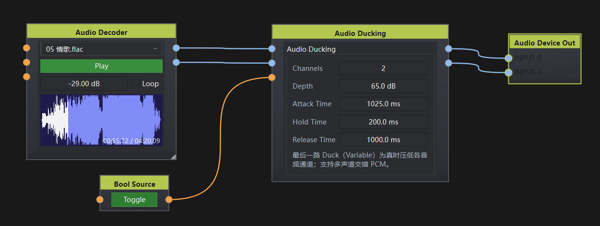

# Audio Ducking

## 1. 节点说明

用 **VariableData** 触发的多通道音频闪避（Ducking）：Duck 为真时，各音频通道按 Depth（dB）衰减；为假后经 Hold 保持、再按 Release 时间常数恢复到 0 dB。不做侧链音频检测。衰减/恢复为 dB 域一阶平滑，包络由全部通道共享推进，逐样本应用线性增益。

## 2. 端口说明

| 方向 | 默认数量 | 可编辑 | 最小 | 最大 | 新增端口类型 | 末端口差异 |
|------|----------|--------|------|------|--------------|------------|
| 输入 | 3（默认 Channels=2 时） | 否 | 2 | 65 | — | 末端口为 Duck（闪避触发） |
| 输出 | 2（默认 Channels=2 时） | 否 | 1 | 64 | — | 无 |

> 本表对应 .flow 中该节点的 `input-count` / `output-count` / `port-editable` 三个字段：
> AI 搭图时连接索引不能超过当前端口数，可编辑节点的取值范围由"最小/最大"给出。
> 端口数量由 **Channels** 属性驱动（音频 1–64 路，默认 2）：输入 = N+1（多一路 Duck），输出 = N，In/Out 一一对应。

### 输入

| 端口 | 名称 | 数据类型 | 说明 |
|------|------|----------|------|
| 0…N-1 | In 1 … In N | AudioData | 被压低的节目通道，须为共享环形缓冲（支持多声道交错 PCM） |
| N | Duck | VariableData | 触发：`true` / 非 0 数值 / `"true"`/`"1"` 开始闪避，其余进入 Hold→Release |

### 输出

| 端口 | 名称 | 数据类型 | 说明 |
|------|------|----------|------|
| 0…N-1 | Out 1 … Out N | AudioData | 与各 In 一一对应，施加闪避增益后的共享环形缓冲 |

## 3. 界面与属性

控件面板（`WidgetEmbeddable=false`，显示在右侧属性面板，不嵌入节点体）：

| 控件 | 范围 | 默认 | 说明 |
|------|------|------|------|
| Channels | 1–64 | 2 | 音频路数，变更即重建端口与处理缓冲 |
| Depth | 0–100 | 20 | 闪避衰减量（dB） |
| Attack Time | 5–10000 | 10 | 落到 Depth 的时间常数（ms） |
| Hold Time | 1–30000 | 200 | Duck 变假后继续保持衰减的时间（ms） |
| Release Time | 10–10000 | 1000 | 保持结束后回到 0 dB 的时间常数（ms） |

公开属性（Q_PROPERTY）：`channels`（int）、`depth`（double）、`attackTime`（double）、`holdTime`（double）、`releaseTime`（double）。

## 4. 外部控制（OSC 地址）

地址前缀：`/dataflow/{别名}/{节点ID}/…`

| 地址 | 方向 | 说明 |
|------|------|------|
| `/channels` | 可写 | 设置音频路数（1–64，越界截断） |
| `/depth` | 可写 | 设置衰减量 dB（0–100） |
| `/attack` | 可写 | 设置 Attack（ms，5–10000） |
| `/hold` | 可写 | 设置 Hold（ms，1–30000） |
| `/release` | 可写 | 设置 Release（ms，10–10000） |
| `/duck` | 可写（仅命令） | 直接触发闪避状态：payload 按 bool/非 0/`"true"`/`"1"` 判定；无对应 Q_PROPERTY，不产生属性反馈 |

## 5. 行为细节

- **处理线程**：Worker 移入独立 QThread，内部另起 std::thread 音频循环（实时优先级 `Pro Audio`）；由各输入环形队列的帧推送唤醒（20ms 超时兜底），不做定时轮询。
- **包络推进**：每拍（系统帧率对应的 48 kHz 采样数）共享推进一次增益，避免多通道倍速；Duck 为真 → 向 `-Depth dB` 做 Attack 一阶逼近，同时重置 Hold 剩余时间；变假后先维持当前衰减走完 Hold，再按 Release 一阶回归 0 dB。
- **逐样本应用**：输出帧内按包络起止 dB 线性插值，每样本乘 `10^(dB/20)`。
- **追帧与延迟**：按时间戳逐帧取输入（落后超 2 帧时单次最多追 8 帧）；缺帧先推迟一次、二次跳过（连续 16 次暂停追赶，绝不填 0）；输出帧时间戳 = 输入帧戳 + 全局音频输出延迟帧数。
- **通道变更**：Channels 修改后按框架端口事件增删 In/Out 端口并重建 Worker 缓冲（旧输出缓冲尽量保留），随后对所有输出端口重发一次 `dataUpdated`。
- **参数传递**：界面/属性/OSC 变更以 Queued 调用推送到 Worker（ms 转秒，下限截断）；启动时一次性同步当前参数。
- **持久化**：`values` 子对象含 `channels`、`depth`、`attack`、`hold`、`release`；加载时兼容 values 缺失（回落顶层键）。
- **析构**：停止处理线程（quit + wait 3 秒）。

## 6. 使用说明与典型接法

1. 用 Channels 设好音频路数。
2. 各节目接到 In，Bool / Trigger / 逻辑节点接到 Duck（或 OSC 写 `/duck`）。
3. Out 接到声卡或下级处理；报幕/广播触发时背景音乐自动压低。

## 7. 示例

Audio Player → In 1/In 2 → Audio Ducking → Audio Device Out；麦克风 Presence 检测节点 → Duck：有人讲话时背景乐压低 20 dB，安静 Hold 200ms 后 1 秒内淡出恢复。
