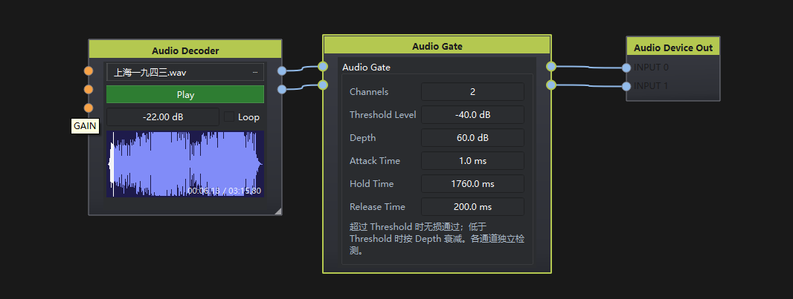

# Audio Gate

## 1. 节点说明

QSC 风格 Noise Gate：各通道根据自身 RMS 独立开/关。帧 RMS 超过 **Threshold Level** 时信号升向 **0 dB 无损通过**；低于阈值时经 Hold / Release 按 **Depth** 衰减。各通道包络互相独立，带 Attack / Hold / Release，避免语句停顿时门反复开关。

## 2. 端口说明

| 方向 | 默认数量 | 可编辑 | 最小 | 最大 | 新增端口类型 | 末端口差异 |
|------|----------|--------|------|------|--------------|------------|
| 输入 | 1（默认 Channels=1 时） | 否 | 1 | 64 | — | 无 |
| 输出 | 1（默认 Channels=1 时） | 否 | 1 | 64 | — | 无 |

> 本表对应 .flow 中该节点的 `input-count` / `output-count` / `port-editable` 三个字段：
> AI 搭图时连接索引不能超过当前端口数，可编辑节点的取值范围由"最小/最大"给出。
> 端口数量由 **Channels** 属性驱动（1–64，默认 1），输入与输出一一对应。

### 输入

| 端口 | 名称 | 数据类型 | 说明 |
|------|------|----------|------|
| 0…N-1 | In 1 … In N | AudioData | 节目通道，须为共享环形缓冲（可为单声道或多声道交错 PCM），各路独立检测 |

### 输出

| 端口 | 名称 | 数据类型 | 说明 |
|------|------|----------|------|
| 0…N-1 | Out 1 … Out N | AudioData | 门控后的对应输出共享环形缓冲 |

## 3. 界面与属性

控件（`WidgetEmbeddable=true`，**嵌入节点体**显示）：

| 控件 | 范围 | 默认 | 说明 |
|------|------|------|------|
| Channels | 1–64 | 1 | 通道数，变更即重建端口与处理缓冲 |
| Threshold Level | -60 ~ 20 | -40 | 开闸门限（全帧 RMS，dB） |
| Depth | 0–60 | 60 | 低于门限时的衰减量（dB），60 dB 接近静音 |
| Attack Time | 0.1–10000 | 1 | 超过门限后增益升到 0 dB 的时间常数（ms） |
| Hold Time | 10–10000 | 100 | 低于门限后继续保持打开的时间（ms） |
| Release Time | 10–10000 | 200 | Hold 结束后衰减到 Depth 的时间常数（ms） |

公开属性（Q_PROPERTY）：`channels`（int）、`thresholdLevel`（double）、`depth`（double）、`attackTime`（double）、`holdTime`（double）、`releaseTime`（double）。

## 4. 外部控制（OSC 地址）

地址前缀：`/dataflow/{别名}/{节点ID}/…`

| 地址 | 方向 | 说明 |
|------|------|------|
| `/channels` | 可写 | 设置通道数（1–64，越界截断） |
| `/threshold` | 可写 | 设置门限 dB（-60 ~ 20） |
| `/depth` | 可写 | 设置衰减量 dB（0–60） |
| `/attack` | 可写 | 设置 Attack（ms，0.1–10000） |
| `/hold` | 可写 | 设置 Hold（ms，10–10000） |
| `/release` | 可写 | 设置 Release（ms，10–10000） |

## 5. 行为细节

- **处理线程**：Worker 移入独立 QThread，内部另起 std::thread 音频循环（实时优先级 `Pro Audio`）；由各输入环形队列的帧推送唤醒（20ms 超时兜底），不做定时轮询。
- **逐通道检测**：每个输入帧计算全帧 RMS（无信号按 -100 dB），与门限比较；**各通道维护独立包络状态**（增益 dB + Hold 剩余时间），互不影响。
- **包络推进**：RMS ≥ 门限 → 重置 Hold 剩余时间、增益按 Attack 一阶逼近 0 dB；低于门限且 Hold 未走完 → 继续向 0 dB 逼近并倒计时；Hold 走完 → 按 Release 一阶逼近 `-Depth dB`。启动时各通道初始增益为关门状态（`-Depth dB`）。
- **逐样本应用**：输出帧内按包络起止 dB 线性插值，每样本乘 `10^(dB/20)`。
- **追帧与延迟**：按时间戳逐帧取输入（落后超 2 帧时单次最多追 8 帧）；缺帧先推迟一次、二次跳过（连续 16 次暂停追赶，绝不填 0）；输出帧时间戳 = 输入帧戳 + 全局音频输出延迟帧数。
- **通道变更**：Channels 修改后按框架端口事件增删 In/Out 端口并重建 Worker 缓冲（旧输出缓冲尽量保留），随后对所有输出端口重发一次 `dataUpdated`。
- **参数传递**：界面/属性/OSC 变更以 Queued 调用推送到 Worker（ms 转秒，范围截断）；启动时一次性同步当前参数。
- **持久化**：`values` 子对象含 `channels`、`threshold`、`depth`、`attack`、`hold`、`release`；加载时兼容 values 缺失（回落顶层键）。
- **析构**：停止处理线程（quit + wait 3 秒）。

## 6. 使用说明与典型接法

1. 用 Channels 设好路数。
2. 话筒等接到 In，Out 接下级处理。
3. 调 Threshold 使有说话时打开、安静时关闭；调 Depth / 时间常数避免呼吸噪声和断句咔嗒声。

## 7. 示例

麦克风（Audio Device In）→ In 1 → Audio Gate → Audio Ducking / 混音器：无人说话时话筒被压低 60 dB，有效抑制底噪与环境声；多支话筒各占一路独立门控。
