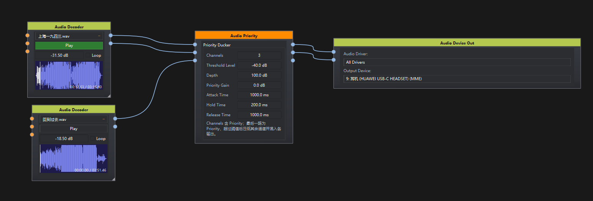

# Audio Priority

## 1. 节点说明

QSC 风格 Priority Ducker（优先级闪避）：最后一路输入为 **Priority**。当它的 RMS 超过 Threshold Level 时，所有节目输出按 Depth 衰减，并把带 Priority Gain 的 Priority 混进这些输出；低于阈值（或无信号）后经 Hold / Release 恢复节目电平，并停止混入。最后一个输出恒为仅 Priority 的直达输出。适合紧急广播、解说压过背景音乐。

## 2. 端口说明

| 方向 | 默认数量 | 可编辑 | 最小 | 最大 | 新增端口类型 | 末端口差异 |
|------|----------|--------|------|------|--------------|------------|
| 输入 | 3（默认 Channels=2 时） | 否 | 2 | 65 | — | 末端口为 Priority（优先级基准音频，AudioData） |
| 输出 | 3（默认 Channels=2 时） | 否 | 2 | 65 | — | 末端口仅输出 Priority × Priority Gain |

> 本表对应 .flow 中该节点的 `input-count` / `output-count` / `port-editable` 三个字段：
> AI 搭图时连接索引不能超过当前端口数，可编辑节点的取值范围由"最小/最大"给出。
> 端口数量由 **Channels** 属性驱动：输入/输出均为 Channels + 1（节目路数 + 1 路 Priority），Channels 范围 1–64，故端口范围为 2–65。

### 输入

| 端口 | 名称 | 数据类型 | 说明 |
|------|------|----------|------|
| 0…N-1 | In 1 … In N | AudioData | 节目通道，须为共享环形缓冲（可为单声道或多声道交错 PCM） |
| N | Priority | AudioData | 优先级 / 基准音频，其 RMS 驱动共享闪避包络 |

### 输出

| 端口 | 名称 | 数据类型 | 说明 |
|------|------|------|------|
| 0…N-1 | Out 1 … Out N | AudioData | 对应节目输入衰减后，再在 Priority 激活时混入 Priority |
| N | Priority | AudioData | 仅 Priority × Priority Gain，不经闪避 |

## 3. 界面与属性

控件（`WidgetEmbeddable=false`，显示在右侧属性面板，不嵌入节点体）：

| 控件 | 范围 | 默认 | 说明 |
|------|------|------|------|
| Channels | 1–64 | 2 | 节目音频路数（不含 Priority），变更即重建端口与处理缓冲 |
| Threshold Level | -60 ~ 20 | -40 | Priority 的 RMS 达到该值后开始闪避（dB），步进 1 |
| Depth | 0–100 | 20 | 闪避时节目通道的衰减量（dB），约 60 dB 相当于基本静音 |
| Priority Gain | -100 ~ 20 | 0 | 混入输出时 Priority 的增益（dB），步进 0.5 |
| Attack Time | 5–10000 | 10 | 节目落到 Depth 的一阶时间常数（ms），步进 1 |
| Hold Time | 1–30000 | 200 | Priority 低于阈值后继续保持闪避的时间（ms），步进 10 |
| Release Time | 10–10000 | 1000 | Hold 走完后节目恢复的一阶时间常数（ms），步进 10 |

公开属性（Q_PROPERTY）：`channels`（int）、`thresholdLevel`（double）、`depth`（double）、`priorityGain`（double）、`attackTime`（double）、`holdTime`（double）、`releaseTime`（double）。

## 4. 外部控制（OSC 地址）

地址前缀：`/dataflow/{别名}/{节点ID}/…`

| 地址 | 方向 | 说明 |
|------|------|------|
| `/channels` | 可写 | 设置节目路数（1–64，越界截断，端口随之增删） |
| `/threshold` | 可写 | 设置触发门限 dB（-60 ~ 20） |
| `/depth` | 可写 | 设置闪避衰减量 dB（0–100） |
| `/priority_gain` | 可写 | 设置 Priority 混入增益 dB（-100 ~ 20，注意带下划线） |
| `/attack` | 可写 | 设置 Attack（ms，5–10000） |
| `/hold` | 可写 | 设置 Hold（ms，1–30000） |
| `/release` | 可写 | 设置 Release（ms，10–10000） |

## 5. 行为细节

- **处理线程**：Worker 移入独立 QThread，内部另起 std::thread 音频循环（实时优先级 `Pro Audio`）；由各输入环形队列的帧推送唤醒（20ms 超时兜底），不做定时轮询。
- **共享包络**：与 Audio Gate 的逐通道独立包络不同，本节点只有**一份共享包络**（增益 dB + Hold 剩余 + 激活标志），由 Priority 输入帧的全帧 RMS 驱动（无信号按 -100 dB）。同一时间戳的包络只推进一次（多个输出共用推进结果）。
- **包络推进**：RMS ≥ 门限 → 重置 Hold 剩余时间、置激活、增益按 Attack 一阶逼近 `-Depth dB`；低于门限但 Hold 未走完 → 继续向 `-Depth` 逼近并倒计时；Hold 走完 → 置非激活、按 Release 一阶逼近 0 dB。**Priority 缺帧/断流也照样推进包络**（按低于阈值处理，进入 Hold→Release 恢复节目），不会永久卡在闪避状态。
- **混音规则**：节目输出样本 = 节目 × `10^(包络dB/20)`，且仅在 Priority 激活（超阈值或 Hold 中）时再叠加 Priority × `10^(PriorityGain/20)`；末路 Priority 输出恒为 Priority × `10^(PriorityGain/20)`，不经闪避。帧内按包络起止 dB 线性插值逐样本应用。
- **追帧与混流**：按时间戳逐帧取输入。节目与 Priority 双源都有连接时每次唤醒最多处理 2 帧（取两源时间戳的较小者对齐，超过 16 帧未更新的源视为过期忽略）；仅单源连接时按普通追帧（落后超 2 帧单次最多追 8 帧；缺帧先推迟一次、二次跳过，连续 16 次暂停追赶，绝不填 0）；多源模式下二次缺帧按 0 混入该路并照常输出。
- **声道适配**：输出声道数取节目/Priority 帧布局；单声道输入自动复制到各输出声道，多声道输入对单声道输出取平均，其余按声道号对齐。
- **延迟**：输出帧时间戳 = 输入帧戳 + 全局音频输出延迟帧数。
- **通道变更**：Channels 修改后按框架端口事件增删 In/Out 端口并重建 Worker 缓冲（旧输出缓冲尽量保留）；场景加载阶段静默调整端口数，避免与反序列化抢连线。
- **参数传递**：界面/属性/OSC 变更以 Queued 调用推送到 Worker（ms 转秒，范围截断）；启动时一次性同步当前参数。
- **持久化**：`values` 子对象含 `channels`、`threshold`、`depth`、`priorityGain`、`attack`、`hold`、`release`；加载时兼容旧键 `priority_gain`，values 缺失时回落顶层键。
- **析构**：停止处理线程（quit + wait 3 秒）。

## 6. 使用说明与典型接法

1. 用 Channels 设好节目路数（不含 Priority）。
2. 背景、分区等节目接到 In 1、In 2…，话筒或警报接到最后一路 Priority。
3. 各 Out 接到对应区域。Priority 超过阈值时，这些输出里的节目被压低，同时听到 Priority；低于阈值后经 Hold/Release 恢复。末路 Priority 输出可单独接监听或紧急分区。

## 7. 示例

背景音乐（Audio Device In）→ In 1、In 2；紧急话筒 → Priority；Out 1/Out 2 → 功放。话筒说话时音乐自动压低 20 dB 并混入话筒声，停顿 200 ms（Hold）后经 1 s（Release）恢复。配合 OSC `/threshold` 可由中控动态调整触发灵敏度。
