# Int Source

## 1. 节点说明

整数常量源。内嵌拖拽数值框，输出当前整数值；输入口可覆盖，值随工程持久化。

## 2. 端口说明

| 方向 | 默认数量 | 可编辑 | 最小 | 最大 | 新增端口类型 | 末端口差异 |
|------|----------|--------|------|------|--------------|------------|
| 输入 | 1 | 否 | 1 | 1 | — | 无 |
| 输出 | 1 | 否 | 1 | 1 | — | 无 |

> 本表对应 .flow 中该节点的 `input-count` / `output-count` / `port-editable` 三个字段：
> AI 搭图时连接索引不能超过当前端口数，可编辑节点的取值范围由"最小/最大"给出。

| 方向 | 端口 | 类型 | 说明 |
|------|------|------|------|
| 入 | （默认） | VariableData | 覆盖当前整数；断开时置 0 |
| 出 | （默认） | VariableData | 当前整数 |

## 3. 界面与属性

内嵌 `IntDragValueWidget` 拖拽数值框（80×30，嵌入节点内）。公开属性：`value`（int）。

## 4. 外部控制（OSC 地址）

地址前缀：`/dataflow/{别名}/{节点ID}/…`

| 地址 | 方向 | 说明 |
|------|------|------|
| `/int` | 读/写 | 绑定属性 `value`。写入时负载转为 int 失败则忽略；读取返回当前整数 |

## 5. 行为细节

- 输入口收到 VariableData 时以 `asInt()` 覆盖当前值；连接断开（数据为空）时置 0。
- 输出口取数返回 `VariableData(value())`。
- 持久化：`save()` 保存 `values.val`；`load()` 恢复。

## 6. 使用说明与典型接法

拖拽或 OSC 改值；需要记忆时用 Source，仅运行时用 Int Variable。

## 7. 示例

### 数学运算
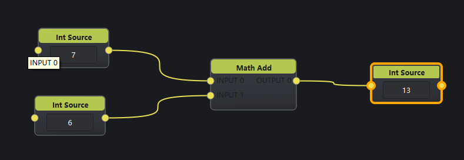

### 转bool类型
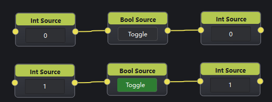

---

# Int Variable

## 1. 节点说明

与 Int Source 相同的端口与界面，**工程不持久化数值**（保存时不保存当前值，下次打开恢复默认 0）。

## 2. 端口说明

| 方向 | 默认数量 | 可编辑 | 最小 | 最大 | 新增端口类型 | 末端口差异 |
|------|----------|--------|------|------|--------------|------------|
| 输入 | 1 | 否 | 1 | 1 | — | 无 |
| 输出 | 1 | 否 | 1 | 1 | — | 无 |

> 本表对应 .flow 中该节点的 `input-count` / `output-count` / `port-editable` 三个字段：
> AI 搭图时连接索引不能超过当前端口数，可编辑节点的取值范围由"最小/最大"给出。

| 方向 | 端口 | 类型 | 说明 |
|------|------|------|------|
| 入 | （默认） | VariableData | 覆盖当前整数；断开时置 0 |
| 出 | （默认） | VariableData | 当前整数 |

## 3. 界面与属性

内嵌 `IntDragValueWidget` 拖拽数值框（同 Int Source）。公开属性：`value`（int）。

## 4. 外部控制（OSC 地址）

地址前缀：`/dataflow/{别名}/{节点ID}/…`

| 地址 | 方向 | 说明 |
|------|------|------|
| `/int` | 读/写 | 绑定属性 `value`；写入负载转 int 失败则忽略 |

## 5. 行为细节

- 输入覆盖与输出语义同 Int Source。
- **不持久化**：工程保存不写入当前值，重新加载后回到默认 0。

## 6. 使用说明与典型接法

作中间计数、临时索引；切场不恢复时用本节点。

## 7. 示例

同 `Int Source`。

---

# Float Source

## 1. 节点说明

浮点常量源。内嵌浮点拖拽控件，值随工程持久化。

## 2. 端口说明

| 方向 | 默认数量 | 可编辑 | 最小 | 最大 | 新增端口类型 | 末端口差异 |
|------|----------|--------|------|------|--------------|------------|
| 输入 | 1 | 否 | 1 | 1 | — | 无 |
| 输出 | 1 | 否 | 1 | 1 | — | 无 |

> 本表对应 .flow 中该节点的 `input-count` / `output-count` / `port-editable` 三个字段：
> AI 搭图时连接索引不能超过当前端口数，可编辑节点的取值范围由"最小/最大"给出。

| 方向 | 类型 | 说明 |
|------|------|------|
| 入 | VariableData | 覆盖当前浮点；断开时置 0.0 |
| 出 | VariableData | 当前浮点 |

## 3. 界面与属性

内嵌浮点拖拽控件。公开属性：`value`（double）。

## 4. 外部控制（OSC 地址）

地址前缀：`/dataflow/{别名}/{节点ID}/…`

| 地址 | 方向 | 说明 |
|------|------|------|
| `/float` | 读/写 | 绑定属性 `value`；写入负载转 double 失败则忽略 |

## 5. 行为细节

- 输入口收到 VariableData 时以 `asNumber()` 覆盖当前值；断开时置 0.0。
- 持久化：`save()` 保存 `values.val`（double）；`load()` 恢复。

## 6. 使用说明与典型接法

增益、混合比、阈值等可复现参数。

## 7. 示例

### 数学运算
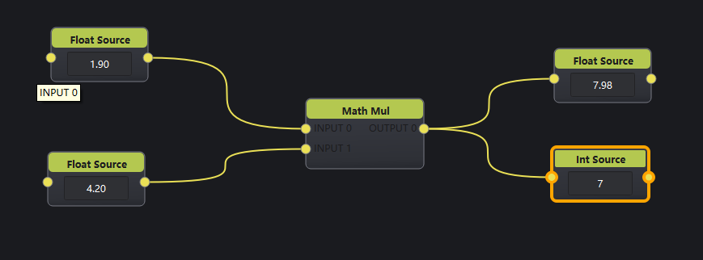

### 类型转换
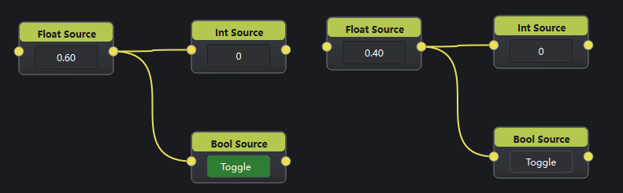

---

# Float Variable

## 1. 节点说明

浮点运行时变量；界面与端口同 Float Source，**不持久化**（重新打开恢复 0.0）。

## 2. 端口说明

| 方向 | 默认数量 | 可编辑 | 最小 | 最大 | 新增端口类型 | 末端口差异 |
|------|----------|--------|------|------|--------------|------------|
| 输入 | 1 | 否 | 1 | 1 | — | 无 |
| 输出 | 1 | 否 | 1 | 1 | — | 无 |

> 本表对应 .flow 中该节点的 `input-count` / `output-count` / `port-editable` 三个字段：
> AI 搭图时连接索引不能超过当前端口数，可编辑节点的取值范围由"最小/最大"给出。

| 方向 | 类型 | 说明 |
|------|------|------|
| 入 | VariableData | 覆盖当前浮点；断开时置 0.0 |
| 出 | VariableData | 当前浮点 |

## 3. 界面与属性

内嵌浮点拖拽控件。公开属性：`value`（double）。

## 4. 外部控制（OSC 地址）

地址前缀：`/dataflow/{别名}/{节点ID}/…`

| 地址 | 方向 | 说明 |
|------|------|------|
| `/float` | 读/写 | 绑定属性 `value` |

## 5. 行为细节

- 输入覆盖与输出语义同 Float Source。
- **不持久化**：重新打开恢复默认 0.0。

## 6. 使用说明与典型接法

LFO / 分析节点的中间结果暂存。

## 7. 示例

同 `Float Source`。

---

# String Source

## 1. 节点说明

字符串常量源。内嵌单行编辑框，值随工程持久化。支持与 float、int、bool 间动态类型转换。

## 2. 端口说明

| 方向 | 默认数量 | 可编辑 | 最小 | 最大 | 新增端口类型 | 末端口差异 |
|------|----------|--------|------|------|--------------|------------|
| 输入 | 1 | 否 | 1 | 1 | — | 无 |
| 输出 | 1 | 否 | 1 | 1 | — | 无 |

> 本表对应 .flow 中该节点的 `input-count` / `output-count` / `port-editable` 三个字段：
> AI 搭图时连接索引不能超过当前端口数，可编辑节点的取值范围由"最小/最大"给出。

| 方向 | 类型 | 说明 |
|------|------|------|
| 入 | VariableData | 覆盖字符串；断开时清空 |
| 出 | VariableData | 当前字符串 |

## 3. 界面与属性

内嵌 `QLineEdit` 单行编辑框。公开属性：`value`（QString）。

## 4. 外部控制（OSC 地址）

地址前缀：`/dataflow/{别名}/{节点ID}/…`

| 地址 | 方向 | 说明 |
|------|------|------|
| `/string` | 读/写 | 绑定属性 `value`；写入负载为字符串 |

## 5. 行为细节

- 输入口收到 VariableData 时以 `asString()` 覆盖；断开时清空为空串。
- 持久化：`save()` 保存 `values.text`；`load()` 恢复。

## 6. 使用说明与典型接法

文件名、OSC 地址片段、设备 ID 等。

## 7. 示例

### 数学运算
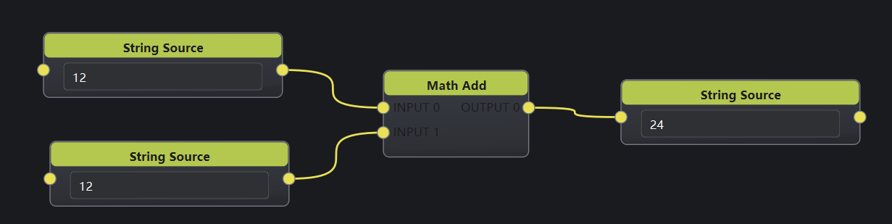

### 数值转换
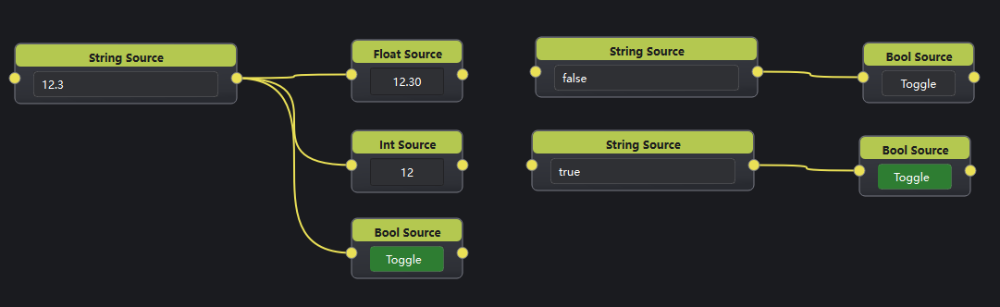

---

# String Variable

## 1. 节点说明

字符串运行时变量；界面与端口同 String Source，**不持久化**（重新打开为空串）。

## 2. 端口说明

| 方向 | 默认数量 | 可编辑 | 最小 | 最大 | 新增端口类型 | 末端口差异 |
|------|----------|--------|------|------|--------------|------------|
| 输入 | 1 | 否 | 1 | 1 | — | 无 |
| 输出 | 1 | 否 | 1 | 1 | — | 无 |

> 本表对应 .flow 中该节点的 `input-count` / `output-count` / `port-editable` 三个字段：
> AI 搭图时连接索引不能超过当前端口数，可编辑节点的取值范围由"最小/最大"给出。

| 方向 | 类型 | 说明 |
|------|------|------|
| 入 | VariableData | 覆盖字符串；断开时清空 |
| 出 | VariableData | 当前字符串 |

## 3. 界面与属性

内嵌 `QLineEdit` 单行编辑框。公开属性：`value`（QString）。

## 4. 外部控制（OSC 地址）

地址前缀：`/dataflow/{别名}/{节点ID}/…`

| 地址 | 方向 | 说明 |
|------|------|------|
| `/string` | 读/写 | 绑定属性 `value` |

## 5. 行为细节

- 输入覆盖与输出语义同 String Source。
- **不持久化**：重新打开恢复空串。

## 6. 使用说明与典型接法

动态文案、临时路径。

## 7. 示例

Extract 字符串字段 → String Variable → To JSON。

---

# Bool Source

## 1. 节点说明

布尔常量源。内嵌勾选按钮，值随工程持久化。

## 2. 端口说明

| 方向 | 默认数量 | 可编辑 | 最小 | 最大 | 新增端口类型 | 末端口差异 |
|------|----------|--------|------|------|--------------|------------|
| 输入 | 1 | 否 | 1 | 1 | — | 无 |
| 输出 | 1 | 否 | 1 | 1 | — | 无 |

> 本表对应 .flow 中该节点的 `input-count` / `output-count` / `port-editable` 三个字段：
> AI 搭图时连接索引不能超过当前端口数，可编辑节点的取值范围由"最小/最大"给出。

| 方向 | 类型 | 说明 |
|------|------|------|
| 入 | VariableData | 覆盖布尔；断开时置 false |
| 出 | VariableData | 当前布尔 |

## 3. 界面与属性

内嵌可勾选按钮。公开属性：`value`（bool）。

## 4. 外部控制（OSC 地址）

地址前缀：`/dataflow/{别名}/{节点ID}/…`

| 地址 | 方向 | 说明 |
|------|------|------|
| `/bool` | 读/写 | 绑定属性 `value`；写入负载转 bool |

## 5. 行为细节

- 输入口收到 VariableData 时以 `asBool()` 覆盖；断开时置 false。
- 持久化：`save()` 保存 `values.val`；`load()` 恢复（缺省为 false）。

## 6. 使用说明与典型接法

开关类默认状态、使能标志。

## 7. 示例

### 类型转换
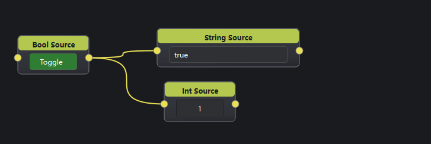

### 逻辑运算
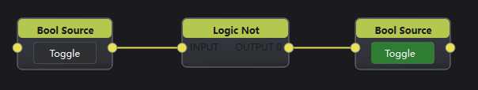

---

# Bool Variable

## 1. 节点说明

布尔运行时变量；界面与端口同 Bool Source，**不持久化**（重新打开为 false）。

## 2. 端口说明

| 方向 | 默认数量 | 可编辑 | 最小 | 最大 | 新增端口类型 | 末端口差异 |
|------|----------|--------|------|------|--------------|------------|
| 输入 | 1 | 否 | 1 | 1 | — | 无 |
| 输出 | 1 | 否 | 1 | 1 | — | 无 |

> 本表对应 .flow 中该节点的 `input-count` / `output-count` / `port-editable` 三个字段：
> AI 搭图时连接索引不能超过当前端口数，可编辑节点的取值范围由"最小/最大"给出。

| 方向 | 类型 | 说明 |
|------|------|------|
| 入 | VariableData | 覆盖布尔；断开时置 false |
| 出 | VariableData | 当前布尔 |

## 3. 界面与属性

内嵌可勾选按钮。公开属性：`value`（bool）。

## 4. 外部控制（OSC 地址）

地址前缀：`/dataflow/{别名}/{节点ID}/…`

| 地址 | 方向 | 说明 |
|------|------|------|
| `/bool` | 读/写 | 绑定属性 `value` |

## 5. 行为细节

- 输入覆盖与输出语义同 Bool Source。
- **不持久化**：重新打开恢复 false。

## 6. 使用说明与典型接法

边沿检测、临时互锁位。

## 7. 示例

同 Bool Source。

---

# Toggle Source

## 1. 节点说明

可锁定的布尔开关（Checkable 按钮）。点击切换真假，值随工程持久化。

## 2. 端口说明

| 方向 | 默认数量 | 可编辑 | 最小 | 最大 | 新增端口类型 | 末端口差异 |
|------|----------|--------|------|------|--------------|------------|
| 输入 | 1 | 否 | 1 | 1 | — | 无 |
| 输出 | 1 | 否 | 1 | 1 | — | 无 |

> 本表对应 .flow 中该节点的 `input-count` / `output-count` / `port-editable` 三个字段：
> AI 搭图时连接索引不能超过当前端口数，可编辑节点的取值范围由"最小/最大"给出。

| 方向 | 类型 | 说明 |
|------|------|------|
| 入 | VariableData | 覆盖开关状态；断开时置 false |
| 出 | VariableData | 当前布尔 |

## 3. 界面与属性

内嵌「Toggle」按钮（可勾选，点击切换而非按下生效）。公开属性：`value`（bool）。

## 4. 外部控制（OSC 地址）

地址前缀：`/dataflow/{别名}/{节点ID}/…`

| 地址 | 方向 | 说明 |
|------|------|------|
| `/bool` | 读/写 | 绑定属性 `value`；写入负载转 bool 直接设定开关状态 |

## 5. 行为细节

- 输入口收到 VariableData 时以 `asBool()` 覆盖开关状态；断开时置 false。
- 与 Bool Source 的区别：按钮为 Checkable 交互（点击在真/假间切换），Bool Source 为即时勾选。
- 持久化：`save()` 保存当前开关状态；`load()` 恢复。

## 6. 使用说明与典型接法

需要手动拨动且记住状态的开关。

## 7. 示例

同 Bool Source。

---

# Toggle Variable

## 1. 节点说明

与 Toggle Source 相同的交互（Checkable 开关），**不持久化**（重新打开为 false）。

## 2. 端口说明

| 方向 | 默认数量 | 可编辑 | 最小 | 最大 | 新增端口类型 | 末端口差异 |
|------|----------|--------|------|------|--------------|------------|
| 输入 | 1 | 否 | 1 | 1 | — | 无 |
| 输出 | 1 | 否 | 1 | 1 | — | 无 |

> 本表对应 .flow 中该节点的 `input-count` / `output-count` / `port-editable` 三个字段：
> AI 搭图时连接索引不能超过当前端口数，可编辑节点的取值范围由"最小/最大"给出。

| 方向 | 类型 | 说明 |
|------|------|------|
| 入 | VariableData | 覆盖开关状态；断开时置 false |
| 出 | VariableData | 当前布尔 |

## 3. 界面与属性

内嵌「Toggle」按钮（同 Toggle Source）。公开属性：`value`（bool）。

## 4. 外部控制（OSC 地址）

地址前缀：`/dataflow/{别名}/{节点ID}/…`

| 地址 | 方向 | 说明 |
|------|------|------|
| `/bool` | 读/写 | 绑定属性 `value` |

## 5. 行为细节

- 输入覆盖与输出语义同 Toggle Source。
- **不持久化**：重新打开恢复 false。

## 6. 使用说明与典型接法

演出中临时拨动、不进工程快照的开关。

## 7. 示例

同 Bool Source。

---

# Trigger Source

## 1. 节点说明

脉冲触发器：点击按钮或输入口收到 `true` 时，输出一次触发脉冲（读出后内部复位）。适合驱动 Inject、Internal Commands、Delay 等「一次性动作」节点。

## 2. 端口说明

| 方向 | 默认数量 | 可编辑 | 最小 | 最大 | 新增端口类型 | 末端口差异 |
|------|----------|--------|------|------|--------------|------------|
| 输入 | 1 | 否 | 1 | 1 | — | 无 |
| 输出 | 1 | 否 | 1 | 1 | — | 无 |

> 本表对应 .flow 中该节点的 `input-count` / `output-count` / `port-editable` 三个字段：
> AI 搭图时连接索引不能超过当前端口数，可编辑节点的取值范围由"最小/最大"给出。

| 方向 | 类型 | 说明 |
|------|------|------|
| 入 | VariableData | `asBool()` 为 `true` 时触发；空数据忽略 |
| 出 | VariableData | 触发后首次取数为 `true`，随后自动复位为 `false` |

## 3. 界面与属性

内嵌 `TriggerWidget`（「Trigger」按钮，最小宽 80）。无公开 Q_PROPERTY。

## 4. 外部控制（OSC 地址）

地址前缀：`/dataflow/{别名}/{节点ID}/…`

| 地址 | 方向 | 说明 |
|------|------|------|
| `/trigger` | 写 | 命令负载为 `true` 时触发一次（`false`/其它值忽略） |
| `/trigger` | 读 | 按钮触发时经 `stateFeedBack` 连续反馈 `true` → `false`（脉冲沿） |

## 5. 行为细节

- 脉冲语义：`setTrigger()` 置内部标志并刷新输出；下游首次取数得到 `true`，之后取数自动返回 `false`（读出后复位），无需手动清零。
- 输入口仅在 `asBool() == true` 时触发，`false` 或断开不动作。
- 无持久化（触发状态不写入工程）。

## 6. 使用说明与典型接法

1. 点击按钮或向输入送 `true`。
2. 将输出接到需要脉冲的下游（Inject、Internal Commands、Delay 等）。

## 7. 示例

### 脉冲计数
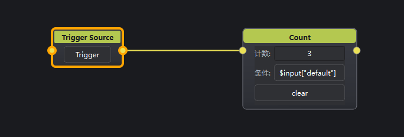

---

# Vector Source

## 1. 节点说明

可变长度向量源。分量是 **float 列表**，输出 **VariableData**（`default` 为列表）。维数由 Size 决定；输入端口可编辑（默认 4 路，末口为整段向量口）。

## 2. 端口说明

| 方向 | 默认数量 | 可编辑 | 最小 | 最大 | 新增端口类型 | 末端口差异 |
|------|----------|--------|------|------|--------------|------------|
| 输入 | 4 | 是 | 1 | 不限 | VariableData | 末端口为 Vec（整组向量一次写入） |
| 输出 | 1 | 是 | 1 | 不限 | VariableData | 无 |

> 本表对应 .flow 中该节点的 `input-count` / `output-count` / `port-editable` 三个字段：
> AI 搭图时连接索引不能超过当前端口数，可编辑节点的取值范围由"最小/最大"给出。

### 输入

| 端口 | 名称 | 说明 |
|------|------|------|
| 0 … n-2 | `0`… | 分量口：标量或列表首元覆盖对应下标分量（超出当前 Size 则忽略） |
| n-1 | Vec | 整段向量；按当前 Size 截断或补 0 |

### 输出

| 端口 | 类型 | 说明 |
|------|------|------|
| Vec | VariableData | `default` 为当前 float 列表 |

## 3. 界面与属性

本节点无节点内嵌界面（`WidgetEmbeddable = false`），控件显示在右侧属性面板：**Size** 维数控件 + 按下标 0、1、2… 排列的分量编辑框。公开属性：`value`（QVariant，float 列表）。

## 4. 外部控制（OSC 地址）

地址前缀：`/dataflow/{别名}/{节点ID}/…`

| 地址 | 方向 | 说明 |
|------|------|------|
| `/vec` | 读/写 | 绑定属性 `value`。写入负载经 `VariableData::asFloats()` 解析（列表 / 标量 / 旧几何类型均可），按当前维数截取或补 0 |

## 5. 行为细节

- Size 控件改维数：以界面为准，仅改变向量长度，不增删端口；改端口数量也不改 Size。
- 分量口写入下标 ≥ 当前 Size 时忽略；Vec 口整段截取/补 0。
- 持久化：`save()` 保存 `values` 数组；`load()` 按存盘内容恢复维数（日常写入不改控件数量），并触发界面尺寸刷新。

## 6. 使用说明与典型接法

解析统一走 `floatVectorFromVariant`（列表 / 标量 / 旧几何类型均可）；需要逐分量接入时用前面的数字口，整段注入时用末尾 Vec 口。

## 7. 示例

### 数据构建
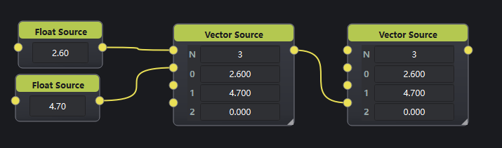

### 转颜色数据
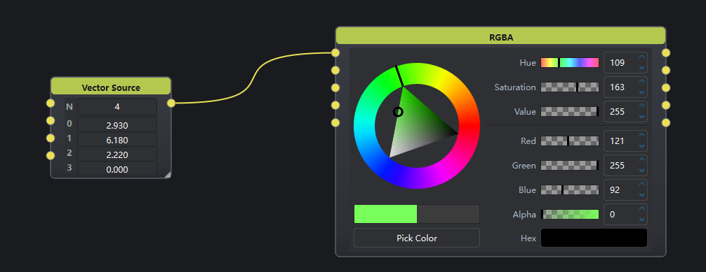

# To JSON

## 1. 节点说明

将字符串解析为 VariableData（JSON 对象）。内嵌可缩放文本框：若文本为合法 JSON **对象**，输出其键值表；否则将原文放入 `default` 字段。

## 2. 端口说明

| 方向 | 默认数量 | 可编辑 | 最小 | 最大 | 新增端口类型 | 末端口差异 |
|------|----------|--------|------|------|--------------|------------|
| 输入 | 1 | 否 | 1 | 1 | — | 无 |
| 输出 | 1 | 否 | 1 | 1 | — | 无 |

> 本表对应 .flow 中该节点的 `input-count` / `output-count` / `port-editable` 三个字段：
> AI 搭图时连接索引不能超过当前端口数，可编辑节点的取值范围由"最小/最大"给出。

| 方向 | 名称 | 类型 | 说明 |
|------|------|------|------|
| 入 | STRING | VariableData | `asString()` 写入编辑框 |
| 出 | JSON | VariableData | 解析后的对象或 `{default: 原文}` |

## 3. 界面与属性

内嵌 `QPlainTextEdit`（`Resizable=true`，显示在右侧属性面板）。编辑即刷新输出。文本随工程持久化（`values.text`）。

## 4. 外部控制（OSC 地址）

本节点未注册任何专属 OSC 地址（源码无 `Q_PROPERTY` 外部属性、无 `registerExternalBinding` 调用）。

地址前缀：`/dataflow/{别名}/{节点ID}/…`。若节点定义了公开 Q_PROPERTY，框架会自动为其生成默认属性地址；本节点当前无此类属性，请通过输入端口或界面编辑内容。

## 5. 行为细节

- 解析时机：下游取数时实时解析编辑框文本。
- 合法 JSON **对象** → 键值表；数组、标量或语法错误 → `{default: 原文}`。
- 输入口断开（空数据）时清空编辑框；上游非法数据按空串处理。

## 6. 使用说明与典型接法

1. 粘贴或输入 JSON；或由上游字符串写入。
2. 下游用 Extract / Condition 读字段。

## 7. 示例

### 文本转json
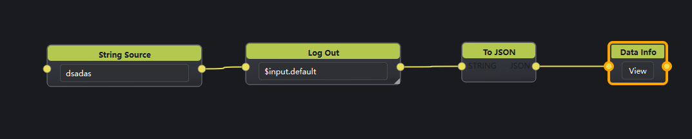

---

# From JSON

## 1. 节点说明

将 VariableData 转为 JSON 文本字符串输出。输入调用 `toJsonString()` 填入编辑框；输出为编辑框纯文本。

## 2. 端口说明

| 方向 | 默认数量 | 可编辑 | 最小 | 最大 | 新增端口类型 | 末端口差异 |
|------|----------|--------|------|------|--------------|------------|
| 输入 | 1 | 否 | 1 | 1 | — | 无 |
| 输出 | 1 | 否 | 1 | 1 | — | 无 |

> 本表对应 .flow 中该节点的 `input-count` / `output-count` / `port-editable` 三个字段：
> AI 搭图时连接索引不能超过当前端口数，可编辑节点的取值范围由"最小/最大"给出。

| 方向 | 名称 | 类型 | 说明 |
|------|------|------|------|
| 入 | JSON | VariableData | 对象/表 → 文本 |
| 出 | STRING | VariableData | 当前文本 |

## 3. 界面与属性

内嵌 `QPlainTextEdit`。文本随工程持久化（`values.text`）；手动改文本也会更新输出。

## 4. 外部控制（OSC 地址）

本节点未注册任何专属 OSC 地址（源码无 `Q_PROPERTY` 外部属性、无 `registerExternalBinding` 调用）。

地址前缀：`/dataflow/{别名}/{节点ID}/…`。若节点定义了公开 Q_PROPERTY，框架会自动为其生成默认属性地址；本节点当前无此类属性。

## 5. 行为细节

- 输入口收到 VariableData 时调用 `toJsonString()` 填入编辑框；断开（空数据）或非法数据时清空。
- 输出为编辑框当前纯文本，不做二次校验。

## 6. 使用说明与典型接法

调试查看对象结构，或把结构化数据发给只收字符串的节点。

## 7. 示例

### JSON转文本
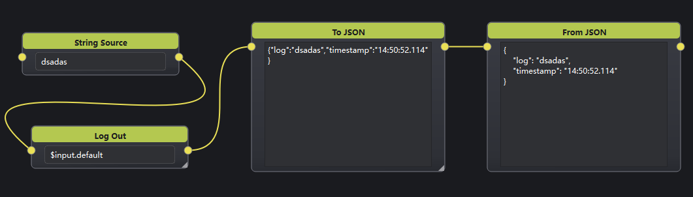

### Variable转文本
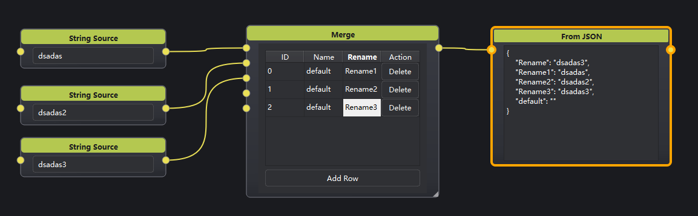

---

# Container

## 1. 节点说明

**子图封装**节点：内部维护一张独立的数据流图（`inner-scene`），外壳端口由子图内全部 **Variable / Image / Audio** 的 In/Out 接口节点汇总暴露。

- 多个 **In** 节点：各自 **Out** 口依次映射到 Container 外壳 **In** 口。
- 多个 **Out** 节点：各自 **In** 口依次映射到 Container 外壳 **Out** 口。
- 双击 Container 进入子图编辑；面包屑返回时自动 `syncInterfaceFromInner` 刷新外壳端口。
- 新建空 Container 时默认放入一对 **Variable In** + **Variable Out**。
- 支持嵌套 Container（`modelAlias` 为 `父别名/节点Id` 链式路径）。
- 子图随 Container 节点一并写入工程（`inner-scene` 字段）。

## 2. 端口说明

| 方向 | 默认数量 | 可编辑 | 最小 | 最大 | 新增端口类型 | 末端口差异 |
|------|----------|--------|------|------|--------------|------------|
| 输入 | 0 | 否 | 0 | 0 | — | 端口为子图入口映射，类型随内部连线变化 |
| 输出 | 0 | 否 | 0 | 0 | — | 端口为子图出口映射，类型随内部连线变化 |

> 本表对应 .flow 中该节点的 `input-count` / `output-count` / `port-editable` 三个字段：
> AI 搭图时连接索引不能超过当前端口数，可编辑节点的取值范围由"最小/最大"给出。

外壳端口**数量与类型**由子图接口节点动态决定，不可手动编辑（`PortEditable=false`）。

| 方向 | 类型 | 说明 |
|------|------|------|
| 入 | 随映射 | 外层数据 → 对应 In 节点的 Out 口 |
| 出 | 随映射 | 对应 Out 节点的 In 口 → 外层数据 |

端口标题（caption）取接口节点 **remarks 第一行** + 本地端口序号（如 `score.0`）；同备注重名时加 `#节点Id` 消歧（如 `score#12.0`）。接口节点增删或改 remarks 时，外壳端口会自动增减并刷新标签。

## 3. 界面与属性

无内嵌控件。双击进入子图画布；子图使用与主流程相同的节点库与编辑能力。

## 4. 外部控制（OSC 地址）

本节点未注册任何专属 OSC 地址。子图内接口节点的 `/input` 地址（见 Variable/Image/Audio In）经嵌套别名链自动挂到 Container 的地址树下，可从外部直接定位子图内部节点。

## 5. 行为细节

- 嵌套寻址：子图内节点 `modelAlias` 为 `父别名/节点Id` 链式路径，OSC 地址随之外层前缀叠加。
- 接口同步：返回外层时 `syncInterfaceFromInner` 按 remarks 重建外壳端口；同备注重名以 `#节点Id` 消歧。
- 持久化：子图完整保存于节点 `inner-scene` 字段，随工程一并加载。

## 6. 使用说明与典型接法

1. 放置 Container，双击进入子图。
2. 在子图内添加 **Variable/Image/Audio In/Out**，按需增删端口（`PortEditable=true`）。
3. 为 In/Out 设置 **remarks**（第一行作为外壳端口名）；子图内完成内部连线。
4. 返回外层，将外层链路接到 Container 外壳端口。
5. 子图内也可再嵌套 Container，形成分层模块。

## 7. 示例

### 打包Container，并暴露端口
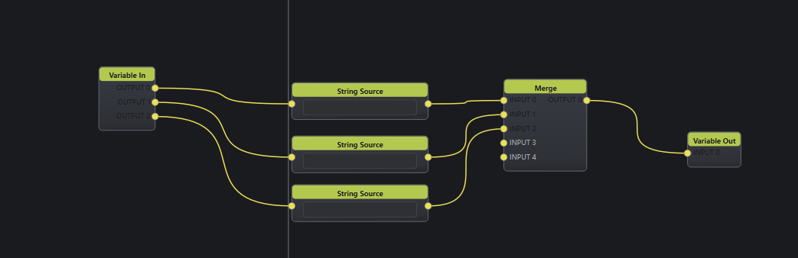

### 直接使用
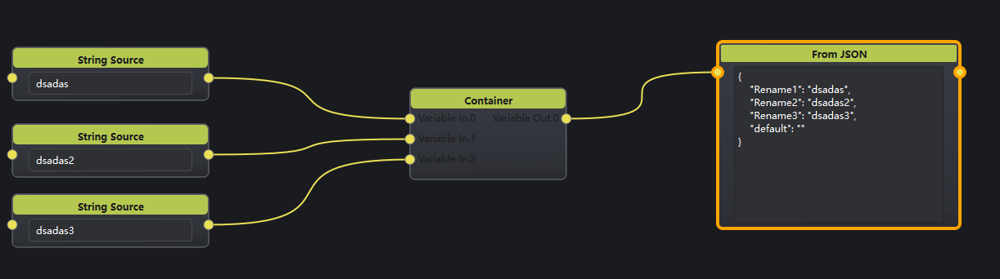

---

# Variable In

## 1. 节点说明

**Container 子图变量入口**：无输入口；外壳 Container 的 In 口注入的数据经 `setInData` 写入后，从本节点 **Out** 口送入子图内部。输出口数量可编辑（`PortEditable=true`）。通常只在 Container 子图内使用。

## 2. 端口说明

| 方向 | 默认数量 | 可编辑 | 最小 | 最大 | 新增端口类型 | 末端口差异 |
|------|----------|--------|------|------|--------------|------------|
| 输入 | 0 | 否 | 0 | 0 | — | 无 |
| 输出 | 1 | 是 | 1 | 不限 | VariableData | 无 |

> 本表对应 .flow 中该节点的 `input-count` / `output-count` / `port-editable` 三个字段：
> AI 搭图时连接索引不能超过当前端口数，可编辑节点的取值范围由"最小/最大"给出。

| 方向 | 类型 | 说明 |
|------|------|------|
| 出 | VariableData | 外壳注入的变量（可多口，按口缓存） |

## 3. 界面与属性

无内嵌控件。**remarks** 第一行用作 Container 外壳 In 口标题（属性 `remarks`）。

## 4. 外部控制（OSC 地址）

地址前缀：`/dataflow/{别名}/{节点ID}/…`

| 地址 | 方向 | 说明 |
|------|------|------|
| `/input` | 写 | 命令负载（字符串）写入 remarks，同步更新外壳端口标题 |

## 5. 行为细节

- `setInData` 按端口缓存注入的 VariableData 并刷新对应输出；输出口与外壳 In 口一一对应。
- remarks 写入时去除首尾空白后生效。

## 6. 使用说明与典型接法

1. 放入 Container 子图，设置 remarks 命名外壳端口。
2. 将子图内下游接到本节点 Out 口。
3. 外层向 Container 对应 In 口送 VariableData 即可驱动子图。

## 7. 示例

同 Container 示例

---

# Variable Out

## 1. 节点说明

**Container 子图变量出口**：子图内部 VariableData 从本节点 **In** 口写入后，由 Container 外壳 **Out** 口中继到外层。无输出口；输入口可编辑（`PortEditable=true`）。

## 2. 端口说明

| 方向 | 默认数量 | 可编辑 | 最小 | 最大 | 新增端口类型 | 末端口差异 |
|------|----------|--------|------|------|--------------|------------|
| 输入 | 1 | 是 | 1 | 不限 | VariableData | 无 |
| 输出 | 0 | 否 | 0 | 0 | — | 无 |

> 本表对应 .flow 中该节点的 `input-count` / `output-count` / `port-editable` 三个字段：
> AI 搭图时连接索引不能超过当前端口数，可编辑节点的取值范围由"最小/最大"给出。

| 方向 | 类型 | 说明 |
|------|------|------|
| 入 | VariableData | 待导出到外壳的变量（可多口） |

## 3. 界面与属性

无内嵌控件。**remarks** 第一行用作 Container 外壳 Out 口标题。

## 4. 外部控制（OSC 地址）

本节点未注册任何专属 OSC 地址（源码无 `Q_PROPERTY` 外部属性、无 `registerExternalBinding` 调用）。

地址前缀：`/dataflow/{别名}/{节点ID}/…`。若节点定义了公开 Q_PROPERTY，框架会自动为其生成默认属性地址；本节点当前无此类属性。

## 5. 行为细节

- 输入口数据经 Container 外壳 Out 口中继到外层；remarks 第一行命名外壳端口。

## 6. 使用说明与典型接法

1. 将子图内计算链路末级接到 Variable Out 的 In 口。
2. 设置 remarks 命名外壳 Out 口。
3. 外层从 Container 对应 Out 口读取数据。

## 7. 示例

同 Container 示例

---

# Image In

## 1. 节点说明

**Container 子图图像入口**：用法同 Variable In，数据类型为 **ImageData**。外壳 Container In 注入图像后，从 Out 口送入子图。

## 2. 端口说明

| 方向 | 默认数量 | 可编辑 | 最小 | 最大 | 新增端口类型 | 末端口差异 |
|------|----------|--------|------|------|--------------|------------|
| 输入 | 0 | 否 | 0 | 0 | — | 无 |
| 输出 | 1 | 是 | 1 | 不限 | ImageData | 无 |

> 本表对应 .flow 中该节点的 `input-count` / `output-count` / `port-editable` 三个字段：
> AI 搭图时连接索引不能超过当前端口数，可编辑节点的取值范围由"最小/最大"给出。

| 方向 | 类型 | 说明 |
|------|------|------|
| 出 | ImageData | 外壳注入的图像（可多口） |

## 3. 界面与属性

无内嵌控件。**remarks** 第一行用作 Container 外壳 In 口标题。

## 4. 外部控制（OSC 地址）

地址前缀：`/dataflow/{别名}/{节点ID}/…`

| 地址 | 方向 | 说明 |
|------|------|------|
| `/input` | 写 | 命令负载（字符串）写入 remarks，同步更新外壳端口标题 |

## 5. 行为细节

- 外壳注入的图像按口缓存后从对应 Out 口送出。

## 6. 使用说明与典型接法

1. 在 Container 子图内放置 Image In，设置 remarks。
2. 外层图像源接到 Container 对应 In 口。
3. 子图内从 Image In Out 口继续接 Image 算子或 Display。

## 7. 示例

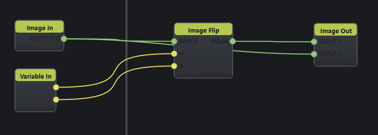
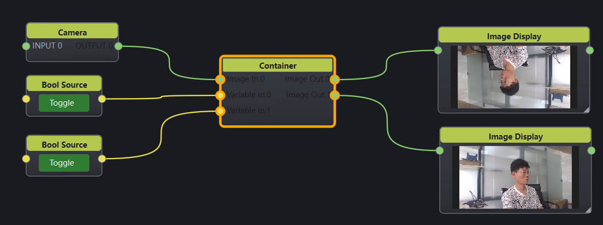

---

# Image Out

## 1. 节点说明

**Container 子图图像出口**：子图内 ImageData 从 In 口写入，由 Container 外壳 Out 中继到外层。无输出口；输入口可编辑。

## 2. 端口说明

| 方向 | 默认数量 | 可编辑 | 最小 | 最大 | 新增端口类型 | 末端口差异 |
|------|----------|--------|------|------|--------------|------------|
| 输入 | 1 | 是 | 1 | 不限 | ImageData | 无 |
| 输出 | 0 | 否 | 0 | 0 | — | 无 |

> 本表对应 .flow 中该节点的 `input-count` / `output-count` / `port-editable` 三个字段：
> AI 搭图时连接索引不能超过当前端口数，可编辑节点的取值范围由"最小/最大"给出。

| 方向 | 类型 | 说明 |
|------|------|------|
| 入 | ImageData | 待导出到外壳的图像（可多口） |

## 3. 界面与属性

无内嵌控件。**remarks** 第一行用作 Container 外壳 Out 口标题。

## 4. 外部控制（OSC 地址）

本节点未注册任何专属 OSC 地址（源码无 `Q_PROPERTY` 外部属性、无 `registerExternalBinding` 调用）。

地址前缀：`/dataflow/{别名}/{节点ID}/…`。若节点定义了公开 Q_PROPERTY，框架会自动为其生成默认属性地址；本节点当前无此类属性。

## 5. 行为细节

- 输入口图像经 Container 外壳 Out 口中继到外层；remarks 第一行命名外壳端口。

## 6. 使用说明与典型接法

将子图内渲染/处理链路末级接到 Image Out，外层从 Container Out 取图。

## 7. 示例

同 Image In 示例

---

# Audio In

## 1. 节点说明

**Container 子图音频入口**：用法同 Variable In，数据类型为 **AudioData**。仅接受已连接共享缓冲区的 AudioData（`isConnectedToSharedBuffer()`）；否则该口输出为空。

## 2. 端口说明

| 方向 | 默认数量 | 可编辑 | 最小 | 最大 | 新增端口类型 | 末端口差异 |
|------|----------|--------|------|------|--------------|------------|
| 输入 | 0 | 否 | 0 | 0 | — | 无 |
| 输出 | 1 | 是 | 1 | 不限 | AudioData | 无 |

> 本表对应 .flow 中该节点的 `input-count` / `output-count` / `port-editable` 三个字段：
> AI 搭图时连接索引不能超过当前端口数，可编辑节点的取值范围由"最小/最大"给出。

| 方向 | 类型 | 说明 |
|------|------|------|
| 出 | AudioData | 外壳注入的音频（可多口） |

## 3. 界面与属性

无内嵌控件。**remarks** 第一行用作 Container 外壳 In 口标题。

## 4. 外部控制（OSC 地址）

地址前缀：`/dataflow/{别名}/{节点ID}/…`

| 地址 | 方向 | 说明 |
|------|------|------|
| `/input` | 写 | 命令负载（字符串）写入 remarks，同步更新外壳端口标题 |

## 5. 行为细节

- 仅缓存已连接共享缓冲区的 AudioData（`isConnectedToSharedBuffer()` 为真）；不满足条件的注入被忽略，该口输出为空。

## 6. 使用说明与典型接法

1. 外层音频源（Decoder、Device In 等共享缓冲链路）接到 Container In。
2. 子图内从 Audio In Out 口接 Audio 处理或 Device Out。

## 7. 示例

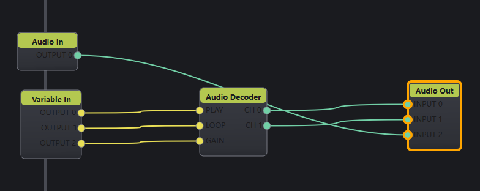
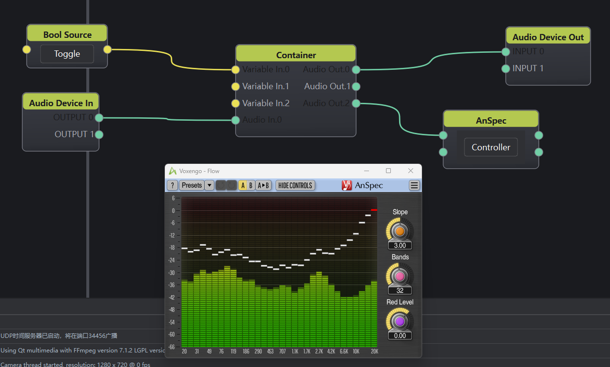

---

# Audio Out

## 1. 节点说明

**Container 子图音频出口**：子图内 AudioData 从 In 口写入，由 Container 外壳 Out 中继到外层。仅缓存已连接共享缓冲区的 AudioData。无输出口；输入口可编辑。

## 2. 端口说明

| 方向 | 默认数量 | 可编辑 | 最小 | 最大 | 新增端口类型 | 末端口差异 |
|------|----------|--------|------|------|--------------|------------|
| 输入 | 1 | 是 | 1 | 不限 | AudioData | 无 |
| 输出 | 0 | 否 | 0 | 0 | — | 无 |

> 本表对应 .flow 中该节点的 `input-count` / `output-count` / `port-editable` 三个字段：
> AI 搭图时连接索引不能超过当前端口数，可编辑节点的取值范围由"最小/最大"给出。

| 方向 | 类型 | 说明 |
|------|------|------|
| 入 | AudioData | 待导出到外壳的音频（可多口） |

## 3. 界面与属性

无内嵌控件。**remarks** 第一行用作 Container 外壳 Out 口标题。

## 4. 外部控制（OSC 地址）

本节点未注册任何专属 OSC 地址（源码无 `Q_PROPERTY` 外部属性、无 `registerExternalBinding` 调用）。

地址前缀：`/dataflow/{别名}/{节点ID}/…`。若节点定义了公开 Q_PROPERTY，框架会自动为其生成默认属性地址；本节点当前无此类属性。

## 5. 行为细节

- 仅缓存已连接共享缓冲区的 AudioData；remarks 第一行命名外壳 Out 口。

## 6. 使用说明与典型接法

子图内音频链路末级 → Audio Out → 外层从 Container Out 取音频。

## 7. 示例

同 Audio In 示例

---

# Image Display

## 1. 节点说明

节点内嵌 **GPU 纹理预览**。订阅系统 tick 与 ring buffer 新帧，零拷贝绑定纹理显示；输出与输入为同一 `ImageData` 句柄（透传，不复制像素）。

## 2. 端口说明

| 方向 | 默认数量 | 可编辑 | 最小 | 最大 | 新增端口类型 | 末端口差异 |
|------|----------|--------|------|------|--------------|------------|
| 输入 | 1 | 否 | 1 | 1 | — | 无 |
| 输出 | 1 | 否 | 1 | 1 | — | 无 |

> 本表对应 .flow 中该节点的 `input-count` / `output-count` / `port-editable` 三个字段：
> AI 搭图时连接索引不能超过当前端口数，可编辑节点的取值范围由"最小/最大"给出。

| 方向 | 类型 | 说明 |
|------|------|------|
| 入 | ImageData | 待预览图像 |
| 出 | ImageData | 透传同一句柄 |

## 3. 界面与属性

`ImageTextureViewHost` 嵌入节点面板（`WidgetEmbeddable = false` 时显示在右侧属性面板）。无公开 Q_PROPERTY。

## 4. 外部控制（OSC 地址）

本节点未注册任何专属 OSC 地址（源码无 `Q_PROPERTY` 外部属性、无 `registerExternalBinding` 调用）。

地址前缀：`/dataflow/{别名}/{节点ID}/…`。若节点定义了公开 Q_PROPERTY，框架会自动为其生成默认属性地址；本节点当前无此类属性。

## 5. 行为细节

- 连接建立/断开时**不在 setInData 内清屏**；清屏由 `updateDisplayFromInput` 在确认无有效帧后执行，避免闪烁。
- 换源/重连时 `setInData` 末尾立即拉一次帧，减少首帧空白。
- 显示走订阅 `newFrameWritten` + tick 的零拷贝路径，与 Window Display 同源。

## 6. 使用说明与典型接法

接在任意 Image 链路中查看当前帧；可继续往后连算子或 Display。

## 7. 示例

同 Image In 示例

---

# Window Display

## 1. 节点说明

在指定显示器上打开独立 OpenGL 窗口显示图像（定位对齐 TouchDesigner Window COMP 常用子集）。刷新策略与 Image Display 同源（tick + `newFrameWritten` + ring buffer）。

## 2. 端口说明

| 方向 | 默认数量 | 可编辑 | 最小 | 最大 | 新增端口类型 | 末端口差异 |
|------|----------|--------|------|------|--------------|------------|
| 输入 | 2 | 否 | 2 | 2 | — | 0 号口为 ImageData 视频帧，其余为 VariableData 控制量 |
| 输出 | 1 | 否 | 1 | 1 | — | 无 |

> 本表对应 .flow 中该节点的 `input-count` / `output-count` / `port-editable` 三个字段：
> AI 搭图时连接索引不能超过当前端口数，可编辑节点的取值范围由"最小/最大"给出。

| 方向 | 端口 | 类型 | 说明 |
|------|------|------|------|
| 入 | IMAGE | ImageData | 显示图像 |
| 入 | OPEN | VariableData | `true`/`false` 打开/关闭窗口 |
| 出 | IMAGE | ImageData | 透传输入图像 |

## 3. 界面与属性

- **标题 / 显示器 / 尺寸**（填满显示器 | 自定义宽高）
- **位置**：居中 | 左上 | 自定义。自定义时 X/Y 相对所选显示器区域左上角（忽略任务栏时按整屏）
- **适配**：Contain / Cover / Stretch
- **边框 / 置顶 / Esc 关闭 / 忽略任务栏**
- **打开窗口**按钮；Esc（可关）或 Shift+Esc（始终）关闭窗口
- 工程持久化上述参数及窗口开闭状态；热插拔显示器时会刷新列表

## 4. 外部控制（OSC 地址）

本节点未注册任何专属 OSC 地址（源码无 `Q_PROPERTY` 外部属性、无 `registerExternalBinding` 调用），窗口开关请使用 OPEN 输入口。

地址前缀：`/dataflow/{别名}/{节点ID}/…`。若节点定义了公开 Q_PROPERTY，框架会自动为其生成默认属性地址；本节点当前无此类属性。

## 5. 行为细节

- OPEN 口：`true` 打开窗口、`false` 关闭；与界面按钮等效。
- 关闭方式：Esc（勾选「Esc 关闭」时）或 Shift+Esc（始终有效）。
- 显示器热插拔时自动刷新显示器列表；窗口开闭状态随工程持久化恢复。

## 6. 使用说明与典型接法

1. 连接图像源到 IMAGE。
2. 选择显示器与尺寸模式，点「打开窗口」或向 OPEN 口送布尔。
3. 投影建议：填满显示器 + Cover + 无边框 + 置顶。

## 7. 示例

Video Decoder → Window Display（副屏演出预览）。

