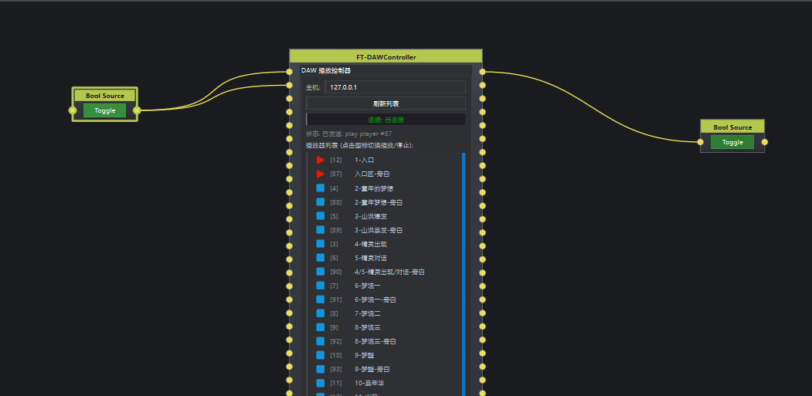

# FT-CurtainController

## 1. 节点说明

> ⚠️ **版本要求**：本节点为 **Advance（进阶版）** 功能，需有效授权后才能加载使用。

通过 TCP 控制 **电动幕帘**：发送开、关、复位指令（`C5` + 地址 + 命令 + `5C`，地址取自主机 IP 末段的两位十六进制）。连接成功后每 3 秒发送一次 `HeartBeat` 心跳文本；收到 `C6` 开头的反馈帧且执行状态为 `0x11` 时，RUNNING 输出为 true。

## 2. 端口说明

| 方向 | 默认数量 | 可编辑 | 最小 | 最大 | 新增端口类型 | 末端口差异 |
|------|----------|--------|------|------|--------------|------------|
| 输入 | 3 | 否 | 3 | 3 | — | 无 |
| 输出 | 1 | 否 | 1 | 1 | — | 无 |

> 本表对应 .flow 中该节点的 `input-count` / `output-count` / `port-editable` 三个字段：
> AI 搭图时连接索引不能超过当前端口数，可编辑节点的取值范围由"最小/最大"给出。


### 输入

| 端口 | 类型 | 说明 |
|------|------|------|
| OPEN | VariableData | 仅 `true` 触发：发送打开指令 `01` |
| CLOSE | VariableData | 仅 `true` 触发：发送关闭指令 `02` |
| RESET | VariableData | 仅 `true` 触发：发送复位指令 `FF` |

### 输出

| 端口 | 类型 | 说明 |
|------|------|------|
| RUNNING | VariableData | 幕帘运行状态（布尔）；收到反馈帧执行状态 `0x11` 时置 true，**源码无复位路径，置 true 后不再变回 false** |

## 3. 界面与属性

控件面板（`WidgetEmbeddable=false`，显示在右侧属性面板，不嵌入节点体）：

| 控件 | 说明 |
|------|------|
| 主机地址输入框 | 幕帘控制器 IP，默认 `192.168.0.10`；编辑完成即重连 |
| 端口数字框 | 默认 `10001`，范围 100–65535；变更即重连 |
| Open / Close / Reset 按钮 | 点击即发送对应指令（与输入端口等效，触发后属性瞬时 true→false） |
| 连接状态按钮 | 只读显示「状态: 已连接 / 未连接」 |

公开属性（Q_PROPERTY）：

| 属性 | 类型 | 说明 |
|------|------|------|
| `host` | string | 控制器 IP（须为 4 段 IPv4，指令编址依赖末段） |
| `port` | int | 端口 |
| `status` | bool | TCP 连接状态（只读） |
| `open` / `close` / `reset` | bool | 脉冲型命令属性：写 true 触发后立即自动复位，写 false 无效 |

## 4. 外部控制（OSC 地址）

地址前缀：`/dataflow/{别名}/{节点ID}/…`

| 地址 | 方向 | 说明 |
|------|------|------|
| `/host` | 可写 | 设置控制器 IP 并重连 |
| `/port` | 可写 | 设置端口并重连 |
| `/open` | 可写 | 写 true 发送打开指令（payload 转布尔，仅 true 生效） |
| `/close` | 可写 | 写 true 发送关闭指令 |
| `/reset` | 可写 | 写 true 发送复位指令 |
| `/status` | 只读 | 连接状态反馈；未订阅 Command，外部写不生效 |

## 5. 行为细节

- **指令构造**：取主机 IP 第 4 段转两位十六进制大写，拼 `C5{地址}{命令}{5C}` 后以 HEX 编码经 TCP 发送（如 IP 末段为 6、开帘 → `C506015C`）；主机不是 4 段 IPv4 时不发送。
- **心跳**：连接成功后启动 **3 秒**定时器，以 UTF-8 文本发送 `HeartBeat`；断开后停止。
- **反馈解析**：收到 ≥5 字节且首字节为 `C6` 的帧时，检查第 4 字节执行状态；为 `0x11` 置 RUNNING=true 并推送输出。其他状态不处理。
- **命令去重**：同一命令属性在脉冲未复位期间重复写 true 不重复发令（端口输入无此去重，每次 true 都发令）。
- **连接管理**：复用全局 TcpClient 设备层（独立线程、断线自动重连）；host/port 变更即断开重连（间隔 20ms）。
- **持久化**：顶层键 `host`、`port`；加载后立即按保存值重连。
- **析构**：停止心跳、断开 TCP。

## 6. 使用说明与典型接法

1. 主机 IP 末段须与幕帘编址一致（指令中嵌入该字节）。
2. 连接成功后可用按钮或 OPEN/CLOSE/RESET 输入触发。
3. RUNNING 可接指示灯或互锁逻辑（注意它不会自动回 false，复位逻辑需自行处理）。
4. 修改主机或端口后会自动重连。

## 7. 示例

场景「演出开始」→ OPEN 输入 `true`；「结束」→ CLOSE；RUNNING 接 Hold 节点做运行中互锁。

---

# FT-ControlBox

## 1. 节点说明

通过 TCP 接收 **点播盒子** 上报的按键/IO 事件，按 **index** 映射到 8 路短脉冲输出。点播盒子需配置为 TCP Server，节点作为 TCP Client 连接（复用全局 TcpClient 设备层，断线自动重连）。

设备三组 IO 共用同一套索引（1～8），节点**不校验类型前缀**（BB/YY/KK 等任意两个字符均可），只匹配地址与索引：

- 面板薄膜：`{485地址}$BB^{index}`
- 遥控器：`{485地址}$YY^{index}`
- IO 线：`{485地址}$KK^{index}`

**地址匹配为两位补零字符串**：485 地址设为 1 时前缀为 `01$`，设备须上报 `01$BB^3`（而非 `1$BB^3`）才会触发 IO 3。

## 2. 端口说明

| 方向 | 默认数量 | 可编辑 | 最小 | 最大 | 新增端口类型 | 末端口差异 |
|------|----------|--------|------|------|--------------|------------|
| 输入 | 0 | 否 | 0 | 0 | — | 无 |
| 输出 | 8 | 否 | 8 | 8 | — | 无 |

> 本表对应 .flow 中该节点的 `input-count` / `output-count` / `port-editable` 三个字段：
> AI 搭图时连接索引不能超过当前端口数，可编辑节点的取值范围由"最小/最大"给出。

### 输入

无输入端口。

### 输出

| 端口 | 类型 | 说明 |
|------|------|------|
| IO 1～IO 8 | VariableData | 对应 index 1～8；触发时输出 true 脉冲，200ms 后自动输出 false；输出可接多路（Many） |

## 3. 界面与属性

控件面板（`WidgetEmbeddable=false`，显示在右侧属性面板，不嵌入节点体）：

| 控件 | 说明 |
|------|------|
| 主机输入框 | 点播盒子 TCP 地址，默认 `127.0.0.1`；编辑完成即重连 |
| 端口数字框 | 默认 `2001`，范围 1–65535；变更即重连 |
| 485 地址数字框 | 默认 `1`，范围 0–255；用于匹配上报消息的地址前缀 |
| IO1～IO8 按钮 | 手动测试触发，对应输出端口同步输出脉冲 |
| 连接状态按钮 | 只读显示「状态: 已连接 / 未连接」 |

公开属性（Q_PROPERTY）：

| 属性 | 类型 | 说明 |
|------|------|------|
| `host` | string | 盒子 IP，变更即重连 |
| `port` | int | 盒子端口，变更即重连 |
| `addr485` | int | 匹配地址（0–255） |
| `connected` | bool | TCP 连接状态（只读） |

## 4. 外部控制（OSC 地址）

地址前缀：`/dataflow/{别名}/{节点ID}/…`

| 地址 | 方向 | 说明 |
|------|------|------|
| `/host` | 可写 | 设置盒子 IP 并重连 |
| `/port` | 可写 | 设置端口并重连 |
| `/addr485` | 可写 | 设置匹配地址（payload 转整数） |
| `/connected` | 只读 | 连接状态反馈；未订阅 Command，外部写不生效 |
| `/IO1`～`/IO8` | 只读 | 触发时推送 true→200ms→false 脉冲；未订阅 Command，外部写不触发输出 |

## 5. 行为细节

- **消息解析**：接收数据按 ASCII 拼入缓冲，以换行（`\r\n` / `\r` / `\n`）分行；每行须以「补零两位的 485 地址 + `$`」开头，`^` 后整数落在 1～8 才触发对应 IO（类型前缀不校验）。
- **脉冲输出**：触发时对应端口先推 true、200ms 后推 false（各自独立 `dataUpdated`）；`/IOx` 地址同步推送 true→200ms→false 反馈。
- **触发来源**：设备上报、界面 IO 按钮共用同一路径（按钮也会同步脉冲输出）。
- **连接管理**：复用 TcpClient（独立线程、断线 1 秒自动重连）；host/port 变更即断开重连并清空接收缓冲。
- **持久化**：`values` 子对象含 `host`、`port`、`addr485`；加载时逐项应用（host/port 变更触发重连）。
- **析构**：断开 TCP。

## 6. 使用说明与典型接法

1. 设置点播盒子的 IP、端口和 485 地址，等待连接成功。
2. 设备上报任一类型消息时，节点按 index 触发对应 IO 端口脉冲（注意地址补零格式）。
3. 也可直接点击界面上的 IO 按钮做联调测试。
4. 将 IO 输出接到后续流程节点即可。

## 7. 示例

- `IO 1` 接"播放开场视频"
- `IO 2` 接"切换灯光场景"
- `IO 3` 接"暂停"

面板、遥控或 IO 线只要 index 相同，都会走同一路输出。

---

# FT-LocationProto

## 1. 节点说明

作为 **TCP Protobuf 服务端**，接收外部船只定位系统上报的位置与 RFID 点位信息，并转换为 `VariableData` 输出到下游节点。协议定义见 `perip2s.proto`（perip2s 帧格式）。

定位设备以 TCP 客户端身份连接本节点；节点自动处理心跳与注册握手，无需额外配置。

**支持的入站消息：**

| 命令 ID | 说明 | 节点行为 |
|---------|------|----------|
| `1` | 心跳 `Heartbeat` | 自动回复心跳 |
| `1602` | 定位系统注册 | 自动回复注册成功（`ret = 1`） |
| `1603` | UWB 位置更新 | 输出到 **POS** 端口 |
| `1604` | RFID 点位更新 | 输出到 **POINT** 端口 |

**TCP 帧格式（大端序）：** `[4 字节 data_len][4 字节 msg_id][msg_body]`，其中 `data_len = 4 + msg_body 长度`，`msg_body` 为 Protobuf 序列化数据。

## 2. 端口说明

| 方向 | 默认数量 | 可编辑 | 最小 | 最大 | 新增端口类型 | 末端口差异 |
|------|----------|--------|------|------|--------------|------------|
| 输入 | 0 | 否 | 0 | 0 | — | 无 |
| 输出 | 2 | 否 | 2 | 2 | — | 末端口为 timestamp（int64 毫秒时间戳） |

> 本表对应 .flow 中该节点的 `input-count` / `output-count` / `port-editable` 三个字段：
> AI 搭图时连接索引不能超过当前端口数，可编辑节点的取值范围由"最小/最大"给出。


### 输入

无输入端口。

### 输出

| 端口 | 类型 | 说明 |
|------|------|------|
| POS | VariableData | UWB 位置更新（命令 `1603`） |
| POINT | VariableData | RFID 点位更新（命令 `1604`） |

**POS 输出字段（`P2SBoatPositioningSysUpdatePos`）：**

| 字段 | 类型 | 说明 |
|------|------|------|
| `default` | float 列表 | 位置向量 `[x, y, z]`（由 `pos` 收成，便于下游按向量消费） |
| `boatId` | int | 船只 ID |
| `pos` | object | 位置坐标 `{ x, y, z }`（float，原始嵌套字段保留） |
| `timestamp` | int64 | 13 位毫秒时间戳 |

**POINT 输出字段（`P2SBoatPositioningSysUpdatePoint`）：**

| 字段 | 类型 | 说明 |
|------|------|------|
| `boatId` | int | 船只 ID |
| `pointId` | int | 位置点 ID |
| `timestamp` | int64 | 13 位毫秒时间戳 |

说明：Protobuf 转 JSON 时字段名为驼峰形式（如 `boat_id` → `boatId`）。每次收到对应消息时更新输出并触发下游刷新。

## 3. 界面与属性

控件面板（`WidgetEmbeddable=false`，显示在右侧属性面板，不嵌入节点体），为自动生成的属性树：

| 属性 | 类型 | 说明 |
|------|------|------|
| `host`（Q_PROPERTY） | string | 监听地址，默认 `0.0.0.0`（所有网卡） |
| `port`（Q_PROPERTY） | int | 监听端口，默认 `9001` |

- TCP 是否成功监听仅为内部状态（`listeningChanged` 信号），未声明为 Q_PROPERTY，也不暴露 OSC 地址。

## 4. 外部控制（OSC 地址）

地址前缀：`/dataflow/{别名}/{节点ID}/…`

| 地址 | 方向 | 说明 |
|------|------|------|
| `/host` | 可写 | 设置监听地址并重启服务 |
| `/port` | 可写 | 设置监听端口并重启服务 |

## 5. 行为细节

- **TCP 服务**：设备层为独立线程的 QTcpServer worker；host/port 变更即关闭旧服务与全部客户端连接、按新参数重建监听；监听结果反馈内部状态。构造时即按默认 `0.0.0.0:9001` 启动。
- **帧格式（大端序）**：`[4 字节 data_len][4 字节 msg_id][msg_body]`，`data_len = 4 + msg_body 长度`；解码器按帧长切包，帧长越界时丢弃 4 字节重同步。
- **入站命令**（`perip2s.proto`）：`1` 心跳（回空 Heartbeat）；`1602` 注册（回 S2P 注册应答 `ret=1`）；`1603` UWB 位置 → **POS** 端口；`1604` RFID 点位 → **POINT** 端口；其他命令记录日志不处理。
- **应答回传**：按消息来源的客户端 IP 定向回包。
- **POS 输出字段**（Protobuf→JSON 驼峰转换）：`default`（float 列表 `[x, y, z]`，由 `pos` 收取）、`boatId`、`pos`（原始 `{x,y,z}`）、`timestamp`（13 位毫秒）。**POINT 输出字段**：`boatId`、`pointId`、`timestamp`。
- **持久化**：顶层键 `host`、`port`；加载后按保存值重启服务。
- **析构**：关闭服务与所有客户端连接。

## 6. 使用说明与典型接法

1. 在节点编辑器中添加 **FT-LocationProto**，确认监听端口（默认 `9001`）未被占用。
2. 将定位设备配置为 TCP 客户端，连接到本机 IP 与对应端口。
3. 设备连接后会自动完成注册与心跳；上报位置或点位时，**POS** / **POINT** 端口输出最新数据。
4. 将 POS 输出接到 Extract、Lookup、Distribute 等节点，可按 `default`（`[x,y,z]`）、`boatId`、`pos.x` 等字段做条件分支或数值处理。
5. 将 POINT 输出接到流程触发逻辑，实现“到达某 RFID 点位即触发动作”。

## 7. 示例

- **实时位置驱动显示**：POS → 下游向量口（直接用 `default` 的 `[x,y,z]`），或 Extract（`$input.pos`）→ 显示/映射节点。
- **按船只分流**：POS → Distribute（条件 `$input.boatId == 1` → 端口 0，`$input.boatId == 2` → 端口 1）。
- **到点触发**：POINT → Condition（`$input.pointId == 5`，接 **DATA** 端口）→ 触发对应场景。

定位设备需实现 `perip2s.proto` 中 P2S 侧协议；本节点负责 S2P 侧注册应答与心跳回复。
---

# FT-DAWController

## 1. 节点说明

面向自研 **DAW 控制器**的播放列表驱动节点，与 SPlayControllerNode 的"轮询 + 端口映射"模式对齐：

- 通过 HTTP **GET `http://{主机}:2004/players`**（默认主机 `127.0.0.1`，**端口固定 `2004`**）每 **2 秒**轮询一次播放列表。
- 解析返回 JSON 中的 `players[]`（字段：`id / name / type / status / enable / sort`），按 `sort` 升序（相同时按 `id` 升序）排序后作为端口顺序。
- **端口数量完全由播放列表驱动，不可手动编辑**：新列表到达后自动增删输入/输出端口，始终保持 **In = N，Out = N**（N = 播放器数量），输入输出端口 i 都对应排序第 i 个播放器。
- 输入端口写 `true` → 向该播放器下发 `play`；写 `false` → 下发 `stop`。
- 指令通过 `FTDAWController` 单例（全局 TCP Client，**端口固定 2003**，ASCII 文本）发出，格式严格为：
  ```
  {"type":"player","id":"1","operate":"play"}/0
  ```

## 2. 端口说明

| 方向 | 默认数量 | 可编辑 | 最小 | 最大 | 新增端口类型 | 末端口差异 |
|------|----------|--------|------|------|--------------|------------|
| 输入 | 0 | 否 | 0 | 0 | — | 数量随播放列表变化（加载后 = 播放器数） |
| 输出 | 0 | 否 | 0 | 0 | — | 同左，与输入一一对应 |

> 本表对应 .flow 中该节点的 `input-count` / `output-count` / `port-editable` 三个字段：
> AI 搭图时连接索引不能超过当前端口数，可编辑节点的取值范围由"最小/最大"给出。
> 输入/输出端口均允许多路连接（Many）。

### 输入（全部 VariableData）

| 端口 | 类型 | 说明 |
|------|------|------|
| `[i] <播放器名称>` | VariableData | 第 i 个播放器控制：写入 `true`/`1`/`"true"`=PLAY，其余=STOP；**每次写入都发令**（便于 Trigger 再次 true 重放） |

### 输出（全部 VariableData）

| 端口 | 类型 | 说明 |
|------|------|------|
| `[i] <播放器名称>` | VariableData | 第 i 个播放器当前是否在播放（`status` 为 `play`/`playing` 判定）；**仅状态变化时才输出** |

> 删除播放器后对应输入/输出端口会自动减少（按 QtNodes 约定先发 `portsAboutToBeDeleted` 再 `portsDeleted`）；连线会按框架策略处理。

## 3. 界面与属性

控件面板（`WidgetEmbeddable=false`，显示在右侧属性面板，不嵌入节点体）：

- **主机**：DAW HTTP 接口所在主机（默认 `127.0.0.1`）；编辑框回车后立即重连 TCP 指令通道并刷新一次列表，HTTP 端口固定为 `2004`（填写的端口部分被忽略）。
- **刷新列表**：立即手动 `GET /players` 一次。
- **连接状态**：由 FTDAWController（TCP 指令通道）就绪状态驱动，HTTP 列表首次请求成功也会置为已连接；下方状态栏显示最近请求提示（请求中 / 已加载 N 个播放器 / JSON 解析失败 / 请求失败原因 / 已发送指令等）。
- **播放器列表（点击图标切换播放/停止）**：每行结构
  - `[播放/停止按钮]`（checkable，图标 = `:/icons/icons/play.png` / `stop.png`，无背景）：点击即 toggle 该播放器（仅状态变化时发令）；
  - `[<真实ID>]`：接口返回的 `players[i].id`；
  - `<名称>`：`players[i].name`，鼠标悬停显示完整字段（index / id / name / type / status / enable / sort）。
  - 正在播放的行自带淡绿底色；已启用但未播放为淡蓝底色。
- 操作后先乐观更新勾选状态，下一轮轮询用设备真实 `status` 校正。

公开属性（Q_PROPERTY）：

| 属性 | 类型 | 说明 |
|------|------|------|
| `host` | string | DAW 主机，变更即重连指令通道 |
| `connected` | bool | 指令通道连接状态（只读） |

## 4. 外部控制（OSC 地址）

地址前缀：`/dataflow/{别名}/{节点ID}/…`

| 地址 | 方向 | 说明 |
|------|------|------|
| `/host` | 可写 | 设置新主机字符串并立即刷新一次列表 |
| `/connected` | 只读 | 指令通道连接状态反馈；未订阅 Command，外部写不生效 |

## 5. 行为细节

- **轮询**：模型就绪后启动 **2 秒**间隔定时器并立即请求一次；同一时刻仅允许一个在途请求（防重入），超时 5 秒；换主机时递增请求代数，丢弃旧地址的迟到回调；请求连续失败 2 次（或从未成功过）才在状态栏报错。
- **URL 清洗**：自动去掉 `http://`/`https://` 前缀、路径与端口部分；主机为空按 `127.0.0.1`；HTTP 端口固定 2004。
- **端口自适应**：列表变化时按框架事件增删输入/输出端口（In=Out=播放器数）；序号越界的端口输入提示"无对应播放器"并忽略。
- **指令下发**：端口/OSC 写入不查变化直接发令；界面按钮仅状态变化时发令。发送后 300ms 自动补一次列表刷新以尽快同步状态。
- **状态判定**：`status == "play" || "playing"` 视为播放中；输出端口仅在值变化时推送 `dataUpdated`。
- **指令通道**：`FTDAWController` 为跨节点共享的单例 TCP Client（端口固定 2003，与 HTTP 列表端口 2004 不同）；多个 DAW 节点共用同一条指令连接。
- **持久化**：`values.host`；兼容旧版存档的 `IP` 字段（`Command`/`port` 旧字段读取后忽略）。
- **析构**：停止轮询、断开回调、释放单例引用。

## 6. 使用说明与典型接法

1. 若 DAW HTTP 接口不在本机，将 **主机** 改为对应 IP（端口 2004 由 DAW 提供，无需配置）。
2. 等状态栏显示 "已加载 N 个播放器"，节点左右两侧会出现对应数量的控制 / 状态端口。
3. 上游连线：
   - 直接 Bool 驱动：某条件成立 → `In[i]=true` 开始播放，条件失效 → `In[i]=false` 停止；
   - 脉冲驱动：Trigger 脉冲 → `In[i]=true` 开始播放，再次 true 也会重新发 play（因为每次写入都发令）。
4. 下游：把 `Out[i]` 接 DataInfo / Condition，仅在状态切换时产生值，避免无谓重算。
5. 界面调试可直接点播放/停止图标按钮，效果近似端口写入（按钮仅状态变化时发令）。

## 7. 示例


时间线片段到 "梦境二"：Trigger 端口 `In[11]` 送 true →
```
{"type":"player","id":"8","operate":"play"}/0
```
DAW 控制器按 id=8 命中 `8-梦境三` 并播放；片段结束时 `In[11]=false` → 对应 stop 指令。
DAW 端默认为 TCP Server（端口 2003，FTDAWController 全局 TCP Client），节点 HTTP 列表端口才是 2004；指令结构保持原生 `{"type":"player","id":"<id>","operate":"play|stop"}/0` 即可，无需在节点内再次编辑。
