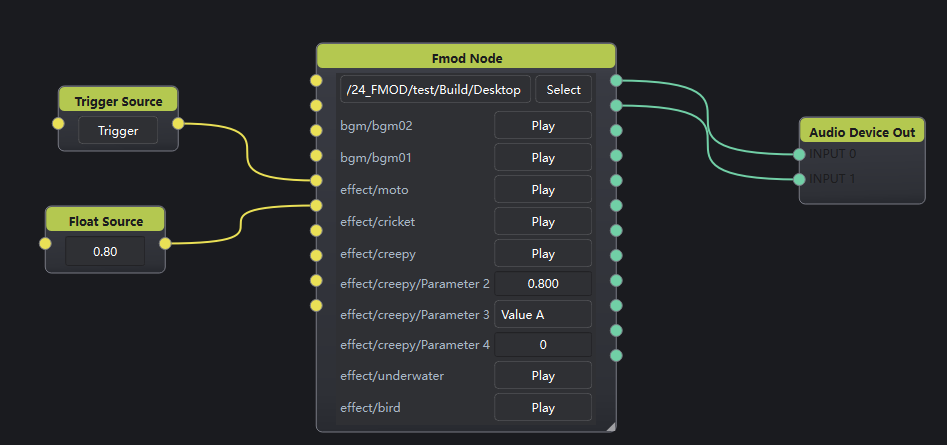

# Fmod Node

## 1. 节点说明

加载 FMOD Studio 导出的 **Bank 目录**，枚举其中事件并播放，最多 **12** 路音频输出。支持多事件叠播、同事件多层叠发（实例上限与偷换由 FMOD Studio 的 Max Instances / Stealing 决定）。适合游戏音效、互动装置等场景。

Core 使用 `NOSOUND`，经 DSP 捕获后走节点图输出；可用 FMOD Studio **Live Update** 连到本进程实时调参。

## 2. 端口说明

| 方向 | 默认数量 | 可编辑 | 最小 | 最大 | 新增端口类型 | 末端口差异 |
|------|----------|--------|------|------|--------------|------------|
| 输入 | 0 | 否 | 0 | 0 | — | 无 |
| 输出 | 12 | 否 | 12 | 12 | — | 无 |

> 本表对应 .flow 中该节点的 `input-count` / `output-count` / `port-editable` 三个字段：
> AI 搭图时连接索引不能超过当前端口数，可编辑节点的取值范围由"最小/最大"给出。

### 输入（随 Bank 动态变化）

加载 Bank 后按事件重建输入口，**每个事件 1 个触发口**；若该事件含用户参数，再紧跟 **每个参数 1 个数值口**。

| 口类型 | 端口类型 | 说明 |
|--------|----------|------|
| 触发（如 `effect/creepy`） | VariableData | `true` 时播放该事件；连线瞬间的 `false` 不触发 |
| 参数（如 `effect/creepy/Parameter 2`） | VariableData | 写入浮点/整型，同步到面板并作用于存活实例 |

仅暴露 **Game Controlled** 用户参数（Continuous / Discrete / Labeled）；内置自动参数（Distance 等）不建口。

### 输出

- **Out 1**～**Out 12**（AudioData）：捕获的多声道输出（RAW 12 声道布局）。

## 3. 界面与属性

| 控件 | 说明 |
|------|------|
| Bank 路径 + Select | 选择含 `.bank` 的文件夹（需含 `strings.bank`） |
| 事件行 | `事件短名` + **Play**（与触发口对应） |
| 参数行 | `事件/参数名` + FloatDrag / IntDrag / 下拉（与参数口对应） |

面板改参会立即更新正在播放的实例，并在下次播放时沿用。

本节点**不**注册 OSC 外部控制与状态反馈；播放与改参仅通过面板与输入口。

## 4. 外部控制（OSC 地址）

地址前缀：`/dataflow/{别名}/{节点ID}/…`

本节点未注册任何专属 OSC 地址（源码头注释明确：无 `Q_PROPERTY` 外部属性、无 `registerExternalBinding` 调用），播放与改参只能通过面板控件和输入端口完成。

## 5. 行为细节

- **架构**：模型持有内嵌 UI 与独立线程上的 FmodDecoderWorker；FMOD Core 以 `NOSOUND` 模式运行，经 DSP 捕获 12 声道写入 12 条输出环形缓冲（`Out 1`–`Out 12`，RAW 布局）。
- **动态端口**：Bank 枚举完成（onEventCatalogUpdated）后重建输入口与面板——每个事件 1 个触发口，随后紧跟该事件的 Game Controlled 用户参数口（Continuous/Discrete/Labeled；内置自动参数不建口）；端口数随 Bank 内容同步增删，`.flow` 中的 input-count 以加载后的实际值为准。
- **触发语义**：触发口数据 `asBool()==true` 才播放（避免连线瞬间的 false 或旧值误触发）；面板 Play 按钮等价于触发。多事件可叠播，同事件多层叠发由 FMOD Studio 的 Max Instances / Stealing 策略决定。
- **参数语义**：参数口 `asNumber()` 写入并同步面板；面板改参立即作用于存活实例并缓存，下次播放沿用。
- **持久化**：`save()` 将 Bank 路径存于顶层 `path`、参数值存于 `params`（键为 `事件路径 + U+001F + 参数名`）；`load()` 先恢复参数表，再设置 Bank 路径触发**异步**加载（队列调用 Worker 的 loadBanks），事件列表重建后参数自动套用。
- **错误路径**：Bank 目录缺少 `.bank`/`strings.bank` 时事件列表为空、无输入口生成。

## 6. 使用说明与典型接法

1. 在 FMOD Studio Build 出 Desktop Bank，保证目录内有 `*.bank` 与 `strings.bank`。
2. 节点内填写或 Select Bank 文件夹；等待事件/参数列表与输入口生成。
3. 用 **Play** 或触发口（`true`）播放；用参数控件或参数口调参。
4. 将 **Out n** 接到混音、分析或声卡节点。
5. （可选）Studio 开启 Live Update 连接本程序，边播边调听感；结构变更后仍需重新 Build 并加载 Bank。

## 7. 示例

- Bool / Trigger → `effect/creepy` 触发口；Float → `effect/creepy/Parameter 2` → Fmod Node → AnSpec / 声卡
- 先播 `bgm/bgm01`，再触发 `effect/...`，可同时出声（多 Instance）

