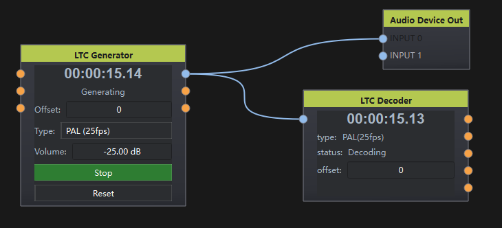

# LTC Decoder

## 1. 节点说明

从音频流中解码 LTC（线性时间码），输出时、分、秒、帧等时间信息，用于同步时间轴或显示。

## 2. 端口说明

| 方向 | 默认数量 | 可编辑 | 最小 | 最大 | 新增端口类型 | 末端口差异 |
|------|----------|--------|------|------|--------------|------------|
| 输入 | 1 | 否 | 1 | 1 | — | 无 |
| 输出 | 5 | 否 | 5 | 5 | — | 无 |

> 本表对应 .flow 中该节点的 `input-count` / `output-count` / `port-editable` 三个字段：
> AI 搭图时连接索引不能超过当前端口数，可编辑节点的取值范围由"最小/最大"给出。

### 输入

- **AUDIO**（AudioData）：含 LTC 信号的音频（通常为单声道线路）。

### 输出

- **FRAMES**（VariableData）：帧数。
- **SECONDS**（VariableData）：秒。
- **MINUTES**（VariableData）：分。
- **HOURS**（VariableData）：时。
- **TOTAL**（VariableData）：换算后的总帧数。

## 3. 界面与属性

时间码显示面板（时:分:秒:帧）+ 解码状态（Connected / Decoding / Disconnected）+ **偏移帧数**数值框（对解码结果整体加减偏移，`WidgetEmbeddable=false`，控件在右侧属性面板）。

## 4. 外部控制（OSC 地址）

地址前缀：`/dataflow/{别名}/{节点ID}/…`

本节点未注册任何专属 OSC 地址（源码无 `Q_PROPERTY` 外部属性、无 `registerExternalBinding` 调用），偏移量只能在属性面板设置。

## 5. 行为细节

- **解码架构**：LTCDecoderWorker 运行于独立 QThread（构造即启动），从共享音频环形缓冲取 PCM 解码；解码结果经信号回主线程。
- **输入语义**：AUDIO 端口需接 AudioData 且已连接共享缓冲；非 AudioData 或未连缓冲按断开处理（状态 Disconnected，停止解码）。
- **偏移处理**：解码帧 + 界面偏移（`timecode_frame_add`）后写入输出；输出 0-3 在每帧解码后与输入变化时刷新。
- **TOTAL 口**：按时间码类型（帧率）将 时/分/秒/帧 换算为总帧数，读取时即时计算。
- **持久化**：工程 JSON 顶层 `offset` 字段（偏移帧数；非 `values` 子对象）。

## 6. 使用说明与典型接法

1. 将调音台或播放器的 LTC 输出接到 Audio Device In。
2. 再接到本节点 AUDIO 端口。
3. 用各输出口驱动 TimeLine、字幕或逻辑节点。

## 7. 示例

播放机 LTC → 声卡输入 → LTC Decoder → TimeLine `/currentFrame`。

