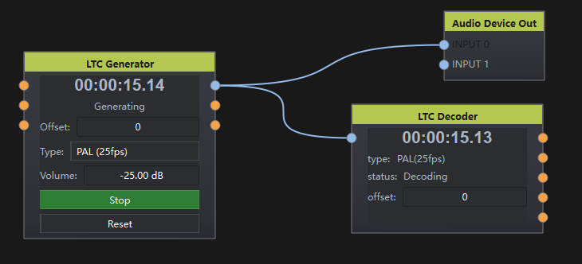

# LTC Generator

## 1. 节点说明

> ⚠️ **版本要求**：本节点为 **Advance（进阶版）** 功能，需有效授权后才能加载使用。

生成 LTC 时间码音频信号并输出，用于同步外部录像机、灯光台等设备。可在界面或端口控制启停、音量与归零，并对外反馈启停与音量状态。

同时是 **SYNC 体系的输出边界节点**：可接入图内同步时钟（SyncData），把图内播放位置反向转换为 LTC 时间码音频输出（SYNC→LTC），供外部设备同步。

## 2. 端口说明

| 方向 | 默认数量 | 可编辑 | 最小 | 最大 | 新增端口类型 | 末端口差异 |
|------|----------|--------|------|------|--------------|------------|
| 输入 | 4 | 否 | 4 | 4 | SyncData | 末端口（3）为 SYNC 从机跟随源 |
| 输出 | 3 | 否 | 3 | 3 | — | 无 |

> 本表对应 .flow 中该节点的 `input-count` / `output-count` / `port-editable` 三个字段：
> AI 搭图时连接索引不能超过当前端口数，可编辑节点的取值范围由"最小/最大"给出。

### 输入

- **START**（VariableData）：true 启动，false 停止。
- **VOLUME**（VariableData）：音量（dB）。
- **RESET**（VariableData）：为 true 时时间码归零。
- **SYNC**（SyncData）：**内部时钟源**：接入后生成器跟随图内同步时钟——源期望位置换算为 LTC 帧号输出（帧差 >1 帧时重置编码器）；源失效时定格输出并静音；断开连线恢复本地自由走时。

### 输出

- **AUDIO**（AudioData）：LTC 音频波形（48 kHz）。
- **START**（VariableData）：当前是否正在生成。
- **VOLUME**（VariableData）：当前音量（dB）。

## 3. 界面与属性

控件面板（`WidgetEmbeddable=false`，显示在右侧属性面板，不嵌入节点体）包含：

| 控件 | 说明 |
|------|------|
| 时间码显示 | 当前生成的时间码（HH:MM:SS:FF） |
| 制式下拉框 | 时间码制式选择，默认 PAL（25 fps），另含其他常用帧率制式 |
| 音量滑块 | 输出音量（dB） |
| 时间码偏移输入框 | 时间码偏移量（帧） |
| Start/Stop 按钮 | 勾选式启停按钮，点击切换生成状态 |
| Reset 按钮 | 点击将时间码归零 |

可外部控制的属性（Q_PROPERTY）：`running`（启停）、`volume`（音量 dB）、`offset`（时间码偏移，帧）、`reset`（归零脉冲）。

## 4. 外部控制（OSC 地址）

地址前缀：`/dataflow/{别名}/{节点ID}/…`

本节点注册了 4 个专属 OSC 地址，均绑定到对应控件并订阅外部 Command（可写）：

| 地址 | 方向 | 说明 |
|------|------|------|
| `/start` | 读写 | 启停生成（bool，绑定 Start/Stop 按钮） |
| `/volume` | 读写 | 音量（dB，绑定音量滑块） |
| `/offset` | 读写 | 时间码偏移（帧，绑定偏移输入框） |
| `/reset` | 读写 | 时间码归零（脉冲属性：置 true 后立即自动回 false） |

## 5. 行为细节

- **音频生成**：生成在 worker 线程中进行，按所选制式的帧率输出 LTC 音频波形（48 kHz），写入共享缓冲后从 AUDIO 口发布，界面刷新不阻塞音频生成。
- **START 输入**：以 `asBool()` 解析，true 启动、false 停止，与界面按钮等效。
- **VOLUME 输入**：以 `asNumber()` 解析为 dB 值，立即生效。
- **RESET 输入**：以 `asBool()` 解析，为 true 时触发归零（与 `/reset` 的脉冲语义一致，触发后自动复位为 false）。
- **输出语义**：START 口实时反映当前生成状态（`_running`），VOLUME 口实时反映当前音量（`_volumeDb`）；AUDIO 口发布共享缓冲中的音频数据，下游节点直接引用同一缓冲。
- **SYNC 跟随（In 3）**：接入 SyncData 后按全局时钟外推源期望位置，用**标称整数帧率**换算为帧号（DF 制式按 30/24 连续编号，不做 29.97/23.976 截断）；与当前输出帧差 >1 帧时重置编码器对齐；源失效（`!active`）时定格最后时间码并静音，源恢复自动继续跟随。
- **持久化**：`save()` 将 `offset`、`timecodeType`、`volume`、`running` 写入顶层 JSON 键（非 `values.*`）；`load()` 恢复这些值，若恢复时 `running` 为 true 会自动重新启动生成。

## 6. 使用说明与典型接法

1. 在界面设置制式与音量，勾选「Start」开始生成（再次点击变为 Stop）。
2. 将 AUDIO 接到 Audio Device Out、VST 或录音链路。
3. 可用 START / VOLUME 端口远程控制，并从同名输出读取当前状态。
4. **图内时钟→LTC**：TimeLineNode 等时钟源的 SYNC 输出接 In 3，本节点把图内播放位置转成 LTC 音频喂给外部设备——图内图外同一时钟。

## 7. 示例

LTC Generator → Audio Device Out → 调音台 LTC 输入，驱动全场时间同步。

**图内转外部**：TimeLineNode Out(SYNC) → LTC Generator In 3（SYNC）→ AUDIO → 声卡输出——时间线播放头实时转成 LTC 时间码，录像机/灯光台跟随图内时间线。

