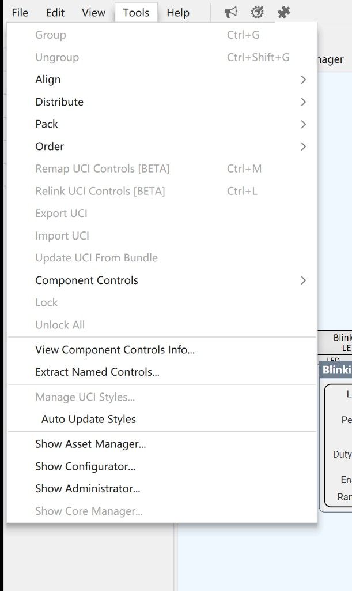

# Q-SYS ECP

## 1. 节点说明

> ⚠️ **版本要求**：本节点为 **Advance（进阶版）** 功能，需有效授权后才能加载使用。

通过 **ECP**（TCP **:1702**，写死）控制 Q-SYS Named Controls。

工作流：

1. Designer：拖控件到 Named Controls → **Tools → Extract Named Controls…** 导出 XML  
2. 把 XML 放进媒体库（Document）  
3. 本节点用 **SelectorComboBox** 选择该文件 → **自动列出全部 Named Control，并同步 In/Out 端口数**  
4. 勾选「连接」连上 Core，读写端口  

文档：[ECP](https://help.qsys.com/q-sys_9.5/Content/External_Control_APIs/ECP/ECP_Overview.htm) · [Named Controls](https://help.qsys.com/q-sys_9.5/Content/Schematic_Library/external_control.htm)

## 2. 端口说明

| 方向 | 默认数量 | 可编辑 | 最小 | 最大 | 新增端口类型 | 末端口差异 |
|------|----------|--------|------|------|--------------|------------|
| 输入 | 0 | 否 | 0 | 随 XML（控件数） | Variable | 无 |
| 输出 | 0 | 否 | 0 | 随 XML（控件数） | Variable | 无 |

> 本表对应 .flow 中该节点的 `input-count` / `output-count` / `port-editable` 三个字段：
> AI 搭图时连接索引不能超过当前端口数，可编辑节点的取值范围由"最小/最大"给出。

`PortEditable = false`。端口数量 = XML 中 Named Control 数量（加载/更换 XML 时自动增删）。

| 方向 | caption | 行为 |
|------|---------|------|
| 输入 `[i] Id` | 写第 i 个控件 | `csv` / `css` / `ct` |
| 输出 `[i] Id` | 当前值 | Change Group `cgs` → `cv` |

## 3. 界面与属性

控件面板（`WidgetEmbeddable=false`，显示在右侧属性面板，不嵌入节点体；节点高度可调）：

| 控件 | 说明 |
|------|------|
| 主机 | Core IP，编辑完成即重连 |
| 用户 / PIN | 可选登录（Core 要求登录时自动尝试） |
| Named Controls XML | 媒体库 Document 选择器，选择后立即解析并重建端口 |
| 连接指示 | 只读状态显示；节点就绪后自动连接，按钮仅作状态/OSC 反馈 |
| 列表 | 全部 Named Control + 实时值（悬停显示 Id/Type/Min/Max 等） |

公开属性：`host`、`userName`、`pin`、`xmlPath` 可写；`connected` 有写方法（勾选=请求连接、取消=请求断开）。

## 4. 外部控制（OSC 地址）

地址前缀：`/dataflow/{别名}/{节点ID}/…`

| 地址 | 方向 | 说明 |
|------|------|------|
| `/host` | 读写 | Core IP；写入后立即应用到连接端点。 |
| `/userName` | 只读 | 登录用户名。未订阅 Command 地址，**外部写入无效**。 |
| `/pin` | 只读 | 登录 PIN。未订阅 Command 地址，**外部写入无效**。 |
| `/xmlPath` | 读写 | Named Controls XML 路径（媒体库相对路径或绝对路径）；写入后立即重新解析并同步端口。 |
| `/connected` | 读写 | `true` 请求连接、`false` 请求断开；实际连接状态变化时自动推送反馈。 |

5 个地址均注册了带属性 member 的绑定：模型就绪时各推送一次初始值，此后属性每次变化自动推送反馈。可写性仅限已订阅的 `/host`、`/xmlPath`、`/connected` 三个。

## 5. 行为细节

- ECP 端口写死 1702；socket 开启自动重连，节点就绪后自动发起连接（无需手动触发）。
- 连接成功后先发 `sg` 取设计信息，200ms 后按需登录（填了用户名才登录），然后建立 Change Group 1：`cgd`/`cgc` 清建 → 逐控件 `cga` 添加 → `cgs 500`（500ms 轮询）→ `cgi`/`cgp`。
- 更换 XML 时按 Id 保留旧控件的缓存值；端口数随控件数对称增删（In/Out 数量相同），`[i] Id` 与控件一一对应。
- 输入写入规则（未连接或控件 Mode=R 时拒绝并提示）：trigger 仅真值触发发 `ct`；boolean 发 `csv id 0/1`；string/enum 发 `css id "…"`；数值类型发 `csv id <数>`（转换失败报错）。真值解析额外接受 `"on"`/`"muted"`。
- 输出值按控件类型转换：boolean/trigger → 布尔（值非 0 或位置 ≥0.5），string/enum → 字符串，integer → 整数，其余 → 浮点；`cv`/`cvv` 回包更新对应输出口与列表。
- 错误提示：未知控件（bad_id）、命令错误、Core 非 Active（冗余待机）、Core 主动关连接（rc）均显示在状态栏。
- 端口连接策略：输入、输出均为 Many。
- 持久化：`values` 子对象 4 键（host / userName / pin / xmlPath）；**connected 不持久化**（每次就绪自动重连）。host/userName/pin 加载失败回落当前值，xmlPath 非空才加载解析。
- 析构时退订全局事件、关闭自动重连并断开 socket、清理状态容器绑定。

## 6. 使用说明与典型接法

基本用法：将上游节点输出接入本节点输入端口，本节点输出端口连接下游节点的对应输入。

## 7. 从 Q-SYS Designer 导出 XML

在 Q-SYS Designer 中选择 **Tools → Extract Named Controls…** 可导出外部控制描述的 XML 文件：

