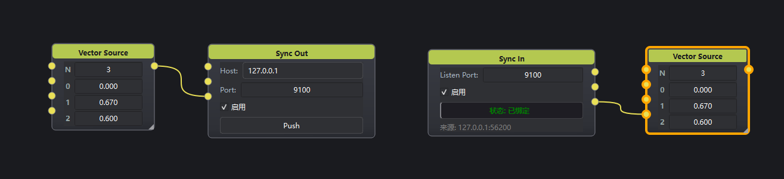

**SyncNode 插件文档**

本插件（`Network` 分类）包含两个节点：**Sync Out** 与 **Sync In**。用于在不同主机 / 进程之间同步多路 `VariableData`。

传输为 **TCP**（行分隔 JSON）。

**角色（支持一对多）：**

| 节点 | 角色 | 说明 |
|------|------|------|
| Sync Out | **TCP 服务端** | 在 Listen Port 上监听，向**所有**已连接的 In 广播 |
| Sync In | **TCP 客户端** | 连到 `Host:Port`；多个 In 可连同一 Out |

**心跳：** Out 每 2s 广播 `{"t":"hb"}`，In 回同样心跳；任一侧 6s 无任何包（含数据/心跳）则判定掉线并清理/重连。同时开启 TCP KeepAlive。

---

# Sync Out

## 1. 节点说明

> ⚠️ **版本要求**：本节点为 **Advance（进阶版）** 功能，需有效授权后才能加载使用。

发送端 / 发布端。监听端口，接受多个 Sync In 连接并广播口数与数值。新客户端连上时会自动 Push 当前缓存。

## 2. 端口说明

| 方向 | 默认数量 | 可编辑 | 最小 | 最大 | 新增端口类型 | 末端口差异 |
|------|----------|--------|------|------|--------------|------------|
| 输入 | 1 | 是 | 1 | 不限 | VariableData | 每口对应一路同步变量，输入口数经 TCP 广播给对端 Sync In |
| 输出 | 0 | 否 | 0 | 0 | — | 无 |

> 本表对应 .flow 中该节点的 `input-count` / `output-count` / `port-editable` 三个字段：
> AI 搭图时连接索引不能超过当前端口数，可编辑节点的取值范围由"最小/最大"给出。


### 输入

| 索引 | 名称 | 数据类型 | 说明 |
|------|------|----------|------|
| 0 | —（未命名） | VariableData | 待广播的第 1 路数值。UI 端口编辑区可加输端口（减号最少保留 1 个），每加一路，广播口数 n 随之 +1 并通知所有 Sync In。断开时：缓存最后值，新客户端连上后由 Push 同步 |

### 输出

无输出端口。数值广播通过 TCP（默认端口 9100）进行，不走节点端口。

## 3. 界面与属性

节点控件面板（`WidgetEmbeddable=false`，显示在右侧属性面板，不嵌入节点体）：

| 控件 | 含义 | 默认 |
|------|------|------|
| Listen Port（数字拖动框） | 本机监听端口 | `9100` |
| 启用（复选框） | 关闭后停止监听 | 开 |
| 状态（标签） | 未监听 / 等待连接 / 已连接 (N) | — |
| Push（按钮） | 向全部客户端重发口数与缓存 | — |

节点公开 4 个 `Q_PROPERTY`：

| 属性 | 类型 | 说明 |
|------|------|------|
| `port` | int | 监听端口（1–65535） |
| `active` | bool | 是否监听 |
| `connected` | bool | 只读，是否有客户端连着 |
| `push` | bool | 脉冲属性：置 `true` 触发一次全量重发后立即自动复位 `false`（写 `false` 无效） |

## 4. 外部控制（OSC 地址）

地址前缀：`/dataflow/{别名}/{节点ID}/…`

| 地址 | 方向 | 说明 |
|------|------|------|
| `/port` | 可写（命令） | 整型，改监听端口；运行中修改立即重启服务端 |
| `/active` | 可写（命令） | 布尔，开启/关闭监听 |
| `/connected` | 只读 | 是否有客户端连接（状态回读） |
| `/push` | 可写（命令） | 置 `true` 向全部客户端重发 schema 与缓存值，随即自动复位 |

`port`/`active`/`push` 订阅 Command 事件，外部写入实时生效；`connected` 仅注册 member 绑定供状态回读，未订阅 Command。

## 5. 行为细节

- **端口语义**：任一输入收到数据即缓存并立即单路广播；收到空数据（断开）时仅从缓存剔除该路，**不广播删除**——对端保持最后值。
- **口数同步（schema）**：300ms 定时器对比当前输入口数与上次广播值，变化即广播 `{"n":N}` schema 包；发送数据前若口数已变也会先补发 schema。
- **新客户端**：连上即开启 KeepAlive，并立即推送 schema + 全部缓存值（补齐状态）。
- **心跳与掉线**：有客户端时每 2s 广播 `{"t":"hb"}`；每 1s 巡检，任一客户端超过 6s 无任何包即判定掉线并断开清理；写入失败的连接同样即时剔除。
- **协议**：见 Sync In 段第 5 节的行分隔 JSON。
- **持久化**：`values.port`、`values.active`；加载后恢复并按需启动监听。

## 6. 使用说明与典型接法

1. 设 Listen Port 并启用 → 「等待连接」。
2. 一个或多个 Sync In 填同一 Port（Host 填本机或 Out 所在机 IP）。
3. Out 显示「已连接 (N)」即可。

## 7. 示例

配合 Sync In 做一对多跨进程同步，见文末 Sync In 的示例。

---

# Sync In

## 1. 节点说明

接收端 / 订阅端。作为客户端连接 Out；断线约每秒重连。

## 2. 端口说明

| 方向 | 默认数量 | 可编辑 | 最小 | 最大 | 新增端口类型 | 末端口差异 |
|------|----------|--------|------|------|--------------|------------|
| 输入 | 0 | 否 | 0 | 0 | — | 无 |
| 输出 | 1 | 否 | 1 | 不限 | — | 运行时按对端 Sync Out 广播的口数自动增减，各口输出对应索引的广播值 |

> 本表对应 .flow 中该节点的 `input-count` / `output-count` / `port-editable` 三个字段：
> AI 搭图时连接索引不能超过当前端口数，可编辑节点的取值范围由"最小/最大"给出。


### 输入

无输入端口。数据来自 Sync Out 的 TCP 广播。

### 输出

| 索引 | 数据类型 | 说明 |
|------|----------|------|
| 0…N-1 | VariableData | 输出口数运行时按对端 Sync Out 广播的口数 n 自动增减（用户不可手动编辑）；第 i 口输出对端第 i 路输入的当前值；断线时保持最后值 |

## 3. 界面与属性

节点控件面板（`WidgetEmbeddable=false`，显示在右侧属性面板，不嵌入节点体）：

| 控件 | 含义 | 默认 |
|------|------|------|
| Host（行编辑框） | Out 所在主机 | `127.0.0.1` |
| Port（数字拖动框） | Out 的 Listen Port | `9100` |
| 启用（复选框） | 关闭后断开 | 开 |
| 状态（标签） | 已连接 / 未连接 | — |
| 对端（标签） | 当前目标 `Host:Port` | — |

节点公开 5 个 `Q_PROPERTY`：

| 属性 | 类型 | 说明 |
|------|------|------|
| `host` | QString | 目标主机（空白自动回落 `127.0.0.1`） |
| `port` | int | 目标端口（1–65535） |
| `active` | bool | 是否连接 |
| `connected` | bool | 只读，连接状态 |
| `lastSource` | QString | 只读，最近连接成功的 `Host:Port`，断开清空 |

## 4. 外部控制（OSC 地址）

地址前缀：`/dataflow/{别名}/{节点ID}/…`

| 地址 | 方向 | 说明 |
|------|------|------|
| `/host` | 可写（命令） | 字符串，改目标主机；运行中修改立即重连 |
| `/port` | 可写（命令） | 整型，改目标端口；运行中修改立即重连 |
| `/listenPort` | 可写（命令） | 旧地址，等效 `/port`（兼容保留） |
| `/active` | 可写（命令） | 布尔，开启/关闭连接 |
| `/connected` | 只读 | 连接状态回读 |
| `/lastSource` | 只读 | 最近成功连接的目标回读 |

`host`/`port`/`active` 订阅 Command 事件，外部写入实时生效；`connected`/`lastSource` 仅注册 member 绑定供状态回读，未订阅 Command。

## 5. 行为细节

一行一条 Compact JSON（`\n` 结尾）：

```json
{"n":4}
{"n":4,"i":0,"v":123}
{"t":"hb"}
```

- `n`：对端输入口数；`i`/`v`：第 i 路数值；`hb`：心跳。默认端口 `9100`。
- **口数自适应**：收到 schema 包（带 `n`）后按行驱动模式自动增减输出口（`portsAboutToBeInserted/Deleted`）；缩口时清除越界缓存；未收到 schema 前保持当前口数。
- **数据丢弃规则**：数据包索引越界（≥ 当前口数）直接丢弃，不扩口。
- **重连**：未连接时每 1s 重试连接；连接后每 1s 巡检收包时间，超过 6s 无任何包（含心跳）判定半开连接，主动断开重连。
- **心跳回应**：收到 `hb` 立即回同样心跳，服务端据此维持会话。
- **缓存语义**：断线时各输出口保持最后值；`lastSource` 清空。
- **持久化**：`values.host`、`values.port`、`values.active`（兼容旧键 `listenPort`）；加载后恢复并按 `active` 连接。

---

## 6. 使用说明与典型接法

多个 In 使用相同 Host+Port → 一对多。不同业务用不同端口隔离。

---

## 7. 示例

**一对多：** 一个 Sync Out（Listen `9101`）+ 两个 Sync In（都连 `127.0.0.1:9101`），两边都应「已连接」，Out 显示 `已连接 (2)`。



